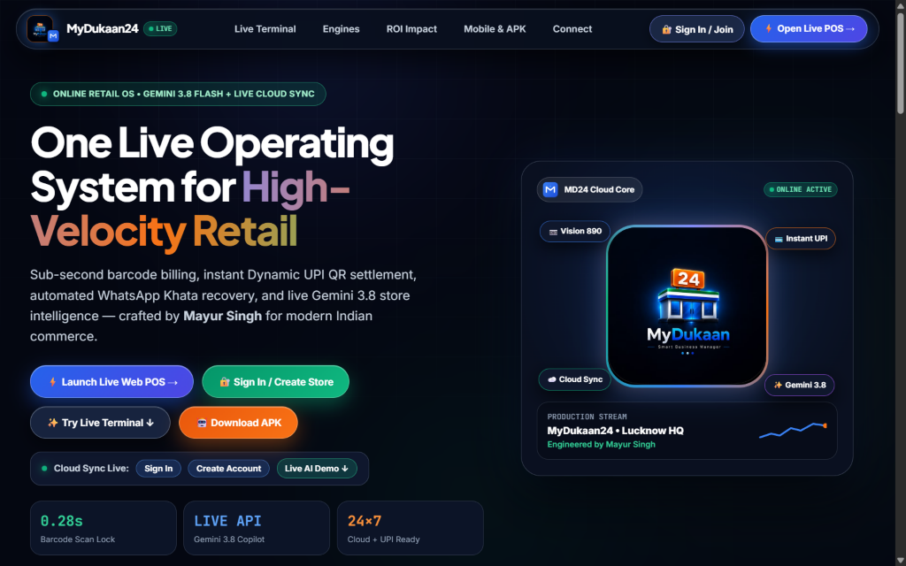
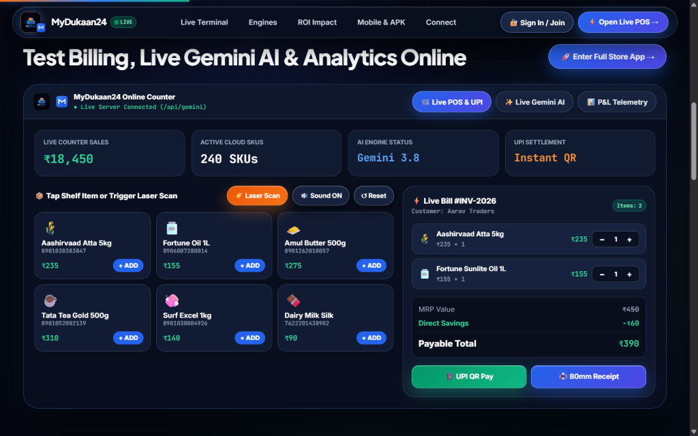
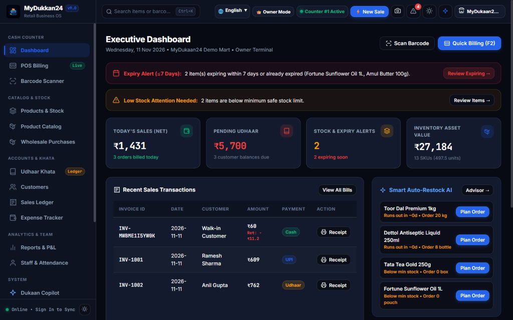
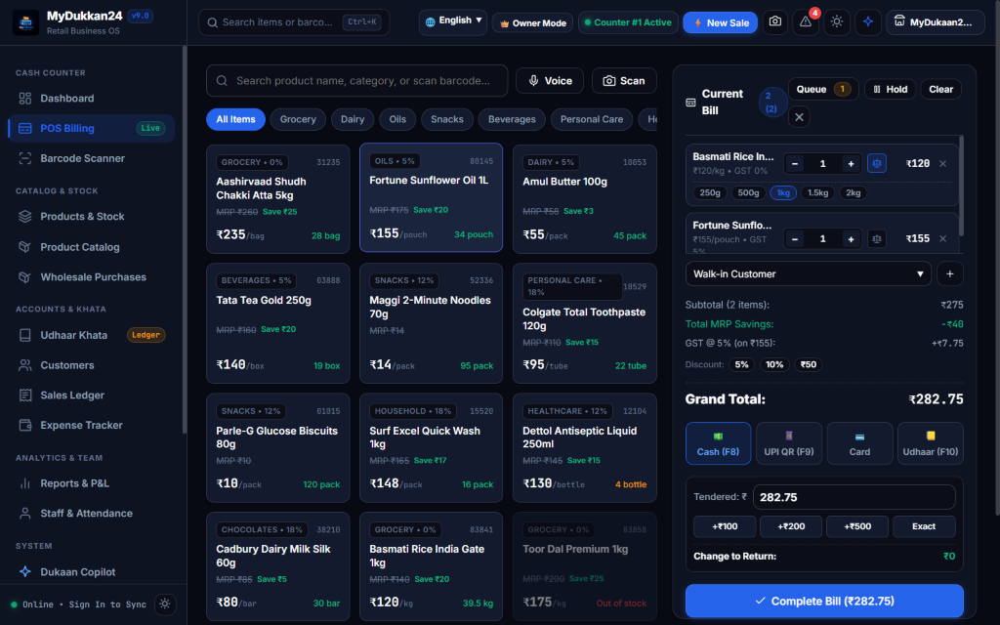
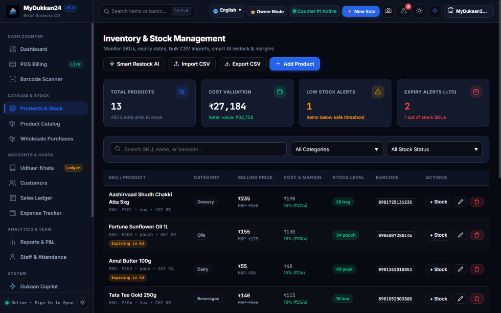
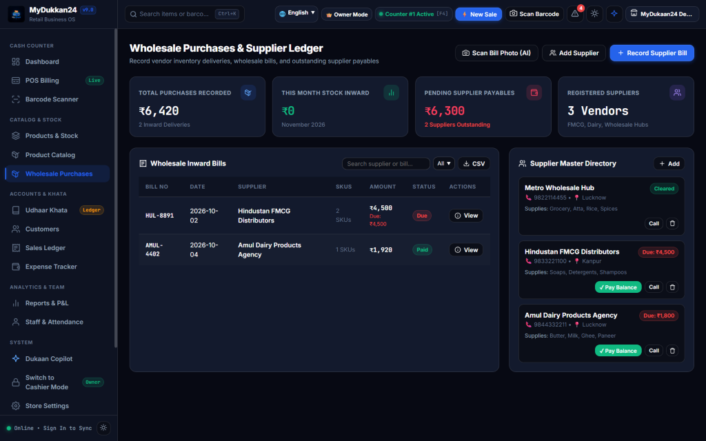
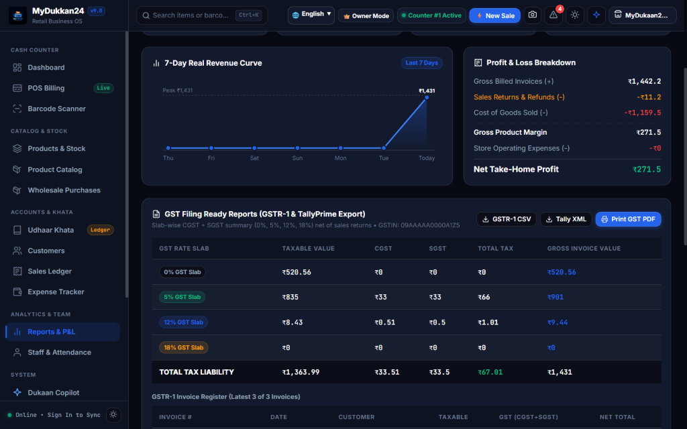
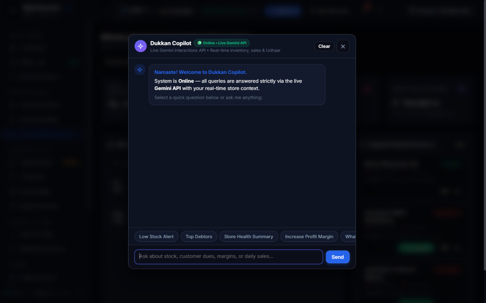
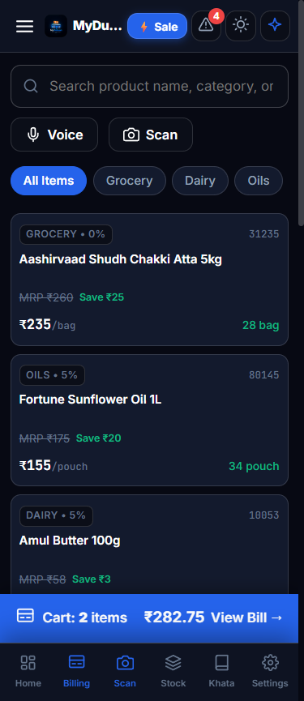
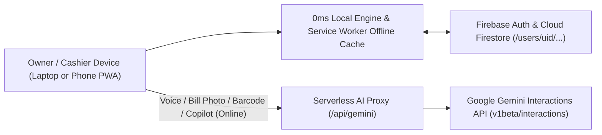

<div align="center">



<br />
<br />

# 🏪 MyDukaan24

### *An Offline-First, AI-Powered Retail Operating System Built for Neighborhood Kirana & General Stores*

[](https://mydukaan-eta.vercel.app/app.html)
[](#-how-it-works--quick-deploy)
[](#-3-core-features--live-app-showcase)
[](#-3-core-features--live-app-showcase)

**[🚀 Launch Live Web POS (`app.html`)](https://mydukaan-eta.vercel.app/app.html)** · **[🌐 Interactive Landing & Sandbox (`index.html`)](https://mydukaan-eta.vercel.app/)** · **[⚡ Netlify Mirror](https://mydukaan24.netlify.app/)** · **[💻 GitHub Repo](https://github.com/mayursingh24/MyDukaan)**

</div>

---

## 📖 1. Why MyDukaan24 Was Built — The Story

**Walk into almost any Indian neighborhood Kirana or general store at 8:30 PM.**

Five customers are standing around a small counter after work. Inside that cramped two-meter space, everything happens at once:

- A family needs **500g loose Toor Dal**, **1.5 kg Basmati Rice**, and **2 packets of Maggi** — mixed items where half of the bill is sold by **decimal weight (`kg` / `litre`)** and the other half by sealed MRP packs.
- Mid-bill, a customer realizes they forgot toothpaste and walks back into the aisle — leaving three impatient buyers stuck waiting behind an open bill.
- A regular neighbor picks up groceries and says, *"Bhaiya, account mein likh lo, salary par de dunga"* (*Udhaar credit*).
- Meanwhile, a distributor drops off a crumpled handwritten **wholesale bill with 35 items**, broadband inside the concrete shop flickers on and off, and the shop owner steps out leaving a young helper on the counter.

When small retailers try existing software to handle this reality, two things break immediately:

1. **Paper Notebooks & Calculators Leak Money Silently:** Loose-weight calculations go wrong under rush pressure, Udhaar pages get lost or never collected on time, milk and dairy batches expire silently on back shelves, and owners have no idea what their *actual* take-home profit was after returns, wholesale dues, and daily rent/electricity expenses.
2. **Enterprise Desktop ERPs & Western Cloud SaaS Don't Fit Indian Counters:** They take minutes to onboard, freeze completely when 4G drops, assume everything has a pre-printed barcode in English, expose confidential cost margins and settings to temporary counter staff, and require 30–45 minutes of tedious typing every night just to enter supplier restock bills.

**MyDukaan24 was built to bridge that exact gap.**
Instead of forcing neighborhood shopkeepers to change how they run their shops to satisfy rigid software, we built a **zero-friction, offline-first Retail Business OS** that speaks **Hindi and 15+ regional languages**, settles bills in **3–5 seconds**, reads paper wholesaler invoices with a **single camera photo**, protects owner margins with **PIN-locked Cashier Mode**, and stays working seamlessly across phones and laptops even when the shop Wi-Fi goes down.

---

## 🎯 2. The Exact Problems We Solve

| Daily Shopkeeper Struggle | Why Traditional Tools Fail | How **MyDukaan24 (`v9.2`)** Solves It |
| :--- | :--- | :--- |
| **Evening Counter Rush & Interrupted Bills** | Slow typing and one stalled customer blocks the entire billing line. | Sub-second POS checkout (`Ctrl+K` / `F2`), USB laser & rear-camera barcode scan, plus **Hold Queue (up to 25 parked carts)** so another customer can be billed immediately. |
| **Mixed Loose Weights vs. Sealed Packets** | Fixed integer quantity counters fail on **250g, 500g, 1.5kg** pulses and oil — or clutter sealed packet UIs. | Precision decimal math with quick chips (**250g, 500g, 1kg, 1.5kg, 2kg**) shown **strictly on loose `kg` / `litre` items**, keeping packaged bags, tubes, and boxes clean. |
| **Language Barrier at Busy Counters** | Typing product names in English during peak hours slows local staff down. | **All-Language Voice Billing (16 languages)** supporting Hindi Devanagari (*"२ पैकेट मैगी और आधा किलो चावल"*), Hinglish, Marathi, Bengali, Tamil, Telugu, Gujarati, and offline Indic script fallback. |
| **Forgotten Udhaar & Awkward Reminders** | Mixed paper ledgers lose track of balances, and owners hesitate to follow up over calls. | Dedicated **Udhaar Khata** separated from **Customers Loyalty CRM**, filterable by *Pending Dues / All / Cleared*, with **1-click formatted WhatsApp payment reminders** + UPI link. |
| **Silent Shelf Expiry & Out-of-Stock Surprises** | Dairy, bread, and FMCG stocks expire unnoticed while fast sellers suddenly hit zero on weekends. | Active **7-Day Expiry Radar** + **30-Day Sales Velocity Smart Auto-Restock** forecasting how many days of stock remain and exact pack quantities to reorder. |
| **Slow Night-Time Wholesale Bill Entry** | Manually typing 40 items from a distributor slip takes half an hour after closing. | **AI Paper Bill Photo Scanner (Gemini Vision)** extracts distributor items, rates, and quantities directly from a photo into your inventory and vendor payable ledger. |
| **Wi-Fi Dropouts & Counter Staff Privacy** | Cloud-only SaaS stops billing offline; shared logins expose profits and allow deletions. | **0ms Offline-First Engine** syncing privately per shop owner to **Cloud Firestore**, plus **SHA-256 PIN-locked Cashier Mode** restricting helpers strictly to Billing, Scanner, and Read-Only Stock. |
| **Monthly GST & Accountant Stress** | Tallying `0% / 5% / 12% / 18%` slabs manually after partial customer returns causes errors. | Return-adjusted **GSTR-1 Tax Slab Reports**, printable GST filing PDF, **TallyPrime XML Sales Vouchers**, Day-End **Cash Drawer Z-Report (`F4`)**, and printable A4 sheets across every module. |

---

## ⚡ 3. Core Features & Live App Showcase (`v9.2`)

Every screenshot below comes directly from the live production app using sanitized demo mart data.

### 🔹 Try Live Before Signing Up — Interactive Landing Simulator & Ten Retail Engines
Visitors can test real cart calculations, amount-locked UPI QR previews, live Gemini AI prompts, revenue curves, and explore all **10 specialized retail engines** directly on the landing page before activating their own store account.

<div align="center">

<br /><sub><i>Interactive POS Simulator, Live Gemini AI Prompting, and P&amp;L Telemetry on the landing page.</i></sub>
</div>

---

### 🔹 Executive Dashboard — Daily Pulse, Expiry Radar & Smart Reorder
See today's return-adjusted net sales, pending credit recovery, expiring-soon dairy/oil alerts, low-stock warnings, inventory valuation, recent transactions, and AI-prioritized reorder plans on one screen.

<div align="center">

<br /><sub><i>Executive Dashboard showing critical expiry alerts (<=7 days), low stock warnings, KPI summary cards, and Smart Auto-Restock suggestions.</i></sub>
</div>

---

### 🔹 High-Speed POS Billing Terminal, 16-Language Voice & Thermal Receipts
- **Instant Capture:** Tap product cards, use **`Ctrl+K`** search, scan via **USB laser gun / device camera** (backed by Open Food Facts + Gemini search + 101-SKU Indian FMCG offline master DB), or speak into the **16-Language Voice Modal**.
- **Flexible Checkout (`F8` Cash / `F9` UPI QR / Card / `F10` Udhaar):** One-tap tender presets, exact cash change calculation, dynamic store UPI QR code, MRP direct savings display, partial/full **Sales Returns** with automatic stock restoration, and **58mm / 80mm Thermal Slip Print** + **1-tap WhatsApp Bill** with sticky controls across desktop and mobile.

<div align="center">

<br /><sub><i>POS Billing counter with queued hold carts, loose-weight quick chips on kg SKUs, automatic GST slab computation, and cash presets.</i></sub>
</div>

---

### 🔹 Inventory & Stock vs. Visual Product Catalog
Instead of duplicating screens, MyDukaan24 separates operational inventory from counter catalog tools:
- **Inventory & Stock:** Full SKU ledger tracking Purchase Cost, Profit Margin %, Selling Price, MRP, Min-Stock triggers, **Expiry Date Radar**, **500+ Row Bulk CSV/Excel Import**, and **Print Stock Sheet**.
- **Product Catalog & Barcode Price Book:** Visual SKU cards featuring crisp inline **SVG Barcode Strips**, per-item `% OFF` badges, **1-click `+ POS Bill`**, single shelf-label printing, **Print All Barcodes**, and **Print Price List**.

<div align="center">

<br /><sub><i>Inventory & Stock view highlighting cost vs. retail valuation, profit margin percentages, active expiry countdown badges, and bulk CSV tools.</i></sub>
</div>

---

### 🔹 Udhaar Khata, Dedicated Customers CRM & 31-Day Staff Payroll
- **Udhaar Khata Ledger:** Focused exclusively on collecting pending credit balances (`Pending Dues / All Accounts / Cleared`), accepting Cash/UPI partial settlements, printing customer statements, and dispatching polite WhatsApp reminders with payment links.
- **Customers Directory & Loyalty CRM:** Tracks Gold / Silver / Bronze tiers, reward points, live order counts, lifetime spend, full purchase history, printable customer directory, and **`⚡ New Bill`** launch into POS.
- **Staff & Attendance:** Visual 31-day muster roll (`Present` / `Half-Day` / `Absent`) with automatic pro-rated monthly salary estimation and printable muster roll.

---

### 🔹 Wholesale Purchases & AI Paper Bill Photo Scanner
Photograph any printed or handwritten distributor invoice: the client compresses the photo cleanly and sends it to **Gemini Vision** to extract vendor info, line items, cost rates, and quantities—matching existing store SKUs or creating new items—while updating **FIFO supplier payables** and stock levels atomically.

<div align="center">

<br /><sub><i>Wholesale Inward Bills and Supplier Directory featuring Gemini Vision invoice scanning and FIFO pending credit settlement.</i></sub>
</div>

---

### 🔹 Real Profit & Loss, Daily Expenses, GSTR-1 & TallyPrime XML
Stop mistaking total sales for actual profit. **Reports & P&L** tracks dynamic `Today`, `7D`, `This Month`, and `All Time` curves, automatically deducting sales returns, COGS, and daily shop expenses (rent, electricity, transport, tea/snacks), alongside ready-to-file **GSTR-1 (`0% / 5% / 12% / 18%` CSV & PDF)** and **TallyPrime Sales Voucher XML** exports.

<div align="center">

<br /><sub><i>Return-adjusted Net Take-Home Profit breakdown paired with GSTR-1 slab tables and 1-click TallyPrime XML / PDF exports.</i></sub>
</div>

---

### 🔹 Dukaan Copilot AI & Pocket-Ready Mobile Counter
- **Dukaan Copilot:** Store-grounded Gemini assistant that inspects real-time inventory, expiring SKUs, debtor dues, and margins to answer business questions in plain English or Hinglish.
- **Pocket Mobile UI (`320px+`) & EN / HI / Hinglish:** Switch entire interface languages instantly without reloading, toggle Dark/Light modes across 5 accent themes, backup/restore full JSON snapshots, and bill from anywhere in the aisle on mobile without horizontal overflow.

<div align="center">
  <table>
    <tr>
      <td width="63%" align="center">
        
        <br /><sub><i>Dukaan Copilot grounded in live store telemetry.</i></sub>
      </td>
      <td width="37%" align="center">
        
        <br /><sub><i>Responsive Mobile POS with floating sticky bill bar.</i></sub>
      </td>
    </tr>
  </table>
</div>

---

## 🔮 4. Future Scope — Where MyDukaan24 Can Grow Next

MyDukaan24 already runs an entire neighborhood store from a single URL. Here is where the platform can expand next:

1. **ONDC & Instant Neighborhood WhatsApp Storefront:**
   Turn your live in-stock catalog into a public hyperlocal store link and ONDC seller feed so nearby households can browse prices, place WhatsApp/web orders, and auto-deduct shelf stock upon dispatch.
2. **Direct Wireless Bluetooth Thermal Printing (Web Bluetooth ESC/POS):**
   Skip OS print dialogs altogether by connecting pocket `58mm` and `80mm` Bluetooth thermal printers straight from mobile Chrome for 1-tap silent bill printing.
3. **Live UPI Soundbox & Automatic Payment Verification:**
   Integrate UPI intent/webhook callbacks and Web Speech audio alerts so every incoming PhonePe / GPay / Paytm settlement marks the bill Paid automatically and announces `"₹245 प्राप्त हुए"` at the counter.
4. **Auto Distributor Reordering & Supplier Portal:**
   Automatically prepare WhatsApp / PDF Purchase Orders for wholesalers whenever the 30-day demand engine sees `< 3 days` of buffer left on staple SKUs.
5. **Multi-Branch Chain Control & Consolidated GST:**
   Manage 2–10 outlets from a single owner account with inter-store stock transfers, branch-level cashier PINs, and consolidated GSTR-1 / Tally exports.
6. **Hardware Scale Sync & Edge On-Device AI:**
   Connect digital weighing scales directly via Web Serial / Bluetooth for auto-populated gram weights, plus local lightweight speech/OCR models so voice billing works smoothly even in zero-network rural areas.

---

## ⚙️ 5. How It Works & Quick Deploy

### System Overview



- **Zero-Build Frontend:** Pure semantic HTML5, modern CSS variables (Dark & Light modes), and modular vanilla ES6+ JavaScript (`index.html`, `app.html`, `sw.js`, `js/*`, `css/*`) — instant load with zero bundler overhead.
- **Hybrid Offline-First Persistence:** Every bill, stock change, expense, and Udhaar payment commits synchronously (`0ms`) in local storage first, queues delta updates cleanly across offline periods, and reconciles via **Firebase Auth + Firestore (`persistentLocalCache`)** under strict per-UID security rules ([`firestore.rules`](firestore.rules)).
- **Resilient AI Pipeline:** Serverless handlers for both **Vercel** ([`api/gemini.js`](api/gemini.js)) and **Netlify** ([`netlify/functions/gemini.js`](netlify/functions/gemini.js)) call Gemini's Interactions API with fast timeout fallbacks across `gemini-3.8-flash` and `gemini-flash-lite` models.

### Quick Setup (Vercel + Firebase)

1. **Fork / Clone** [`mayursingh24/MyDukaan`](https://github.com/mayursingh24/MyDukaan) and import into [Vercel](https://vercel.com/new) (Framework Preset: **Other**, empty Output Directory).
2. Add Environment Variable **`GEMINI_API_KEY`** from [Google AI Studio](https://aistudio.google.com/api-keys) in Vercel Project Settings, then redeploy.
3. In [Firebase Console](https://console.firebase.google.com/), enable **Authentication** (**Google** + **Email/Password**), add your deployed domain under **Authorized domains**, create a **Cloud Firestore (Standard Edition)** database, and publish [`firestore.rules`](firestore.rules).
4. Open the live URL, create your store account, or install directly via **Add to Home Screen / Install PWA** for everyday counter use.

### Essential Counter Shortcuts

| Key | Action |
| :---: | :--- |
| **`Ctrl + K`** | Focus item & barcode search |
| **`F2` / `F3`** | Open POS Billing / Barcode Scanner |
| **`F4`** | Open Cash Drawer & Z-Report |
| **`F8` / `F9` / `F10`** | Select **Cash** / **UPI QR** / **Udhaar** payment mode |
| **`Esc`** | Close active modal or drawer |

---

## 📁 Project Structure

```text
MyDukaan-v4/
├── api/gemini.js                 # Vercel Serverless Gemini Interactions proxy
├── netlify/functions/gemini.js   # Netlify Serverless mirror
├── css/                          # Theme tokens, POS components & landing styles
├── docs/images/                  # Live app UI showcase screenshots
├── js/                           # Modular POS, Inventory, Purchases, Khata, Staff, Analytics, AI & Firebase sync
├── index.html                    # Product landing page, interactive sandbox & Cloud Auth gate
├── app.html                      # Core Retail Business OS terminal
├── firestore.rules               # Per-UID Firestore isolation & schema rules
└── sw.js                         # Network-First PWA Service Worker
```

---

## 👨‍💻 Author & License

Built by **Mayur Singh** (Lucknow, India) · [GitHub (`mayursingh24/MyDukaan`)](https://github.com/mayursingh24/MyDukaan) · [LinkedIn (`mayursingh24`)](https://linkedin.com/in/mayursingh24)

© 2026 Mayur Singh — Built for Indian Retail Commerce & Hackathon Showcase.
