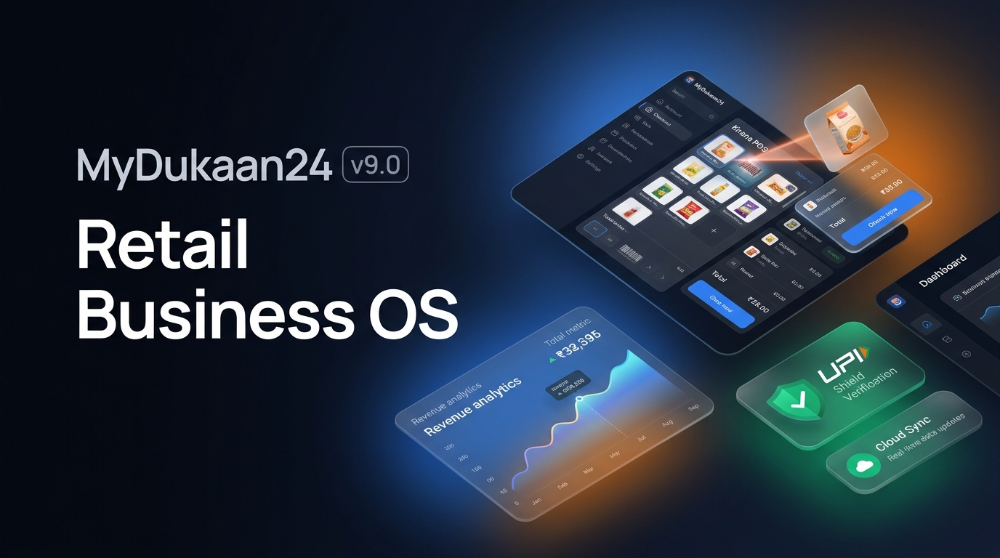
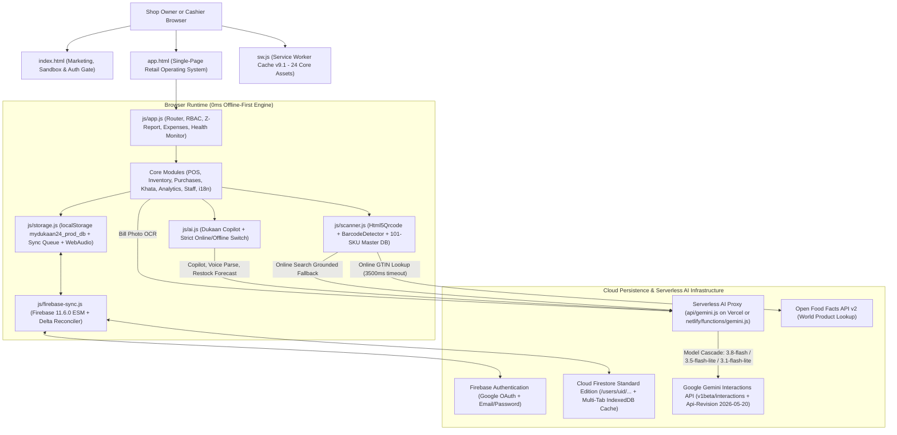
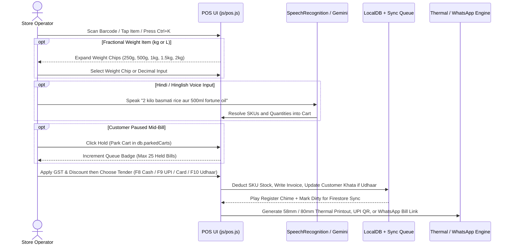
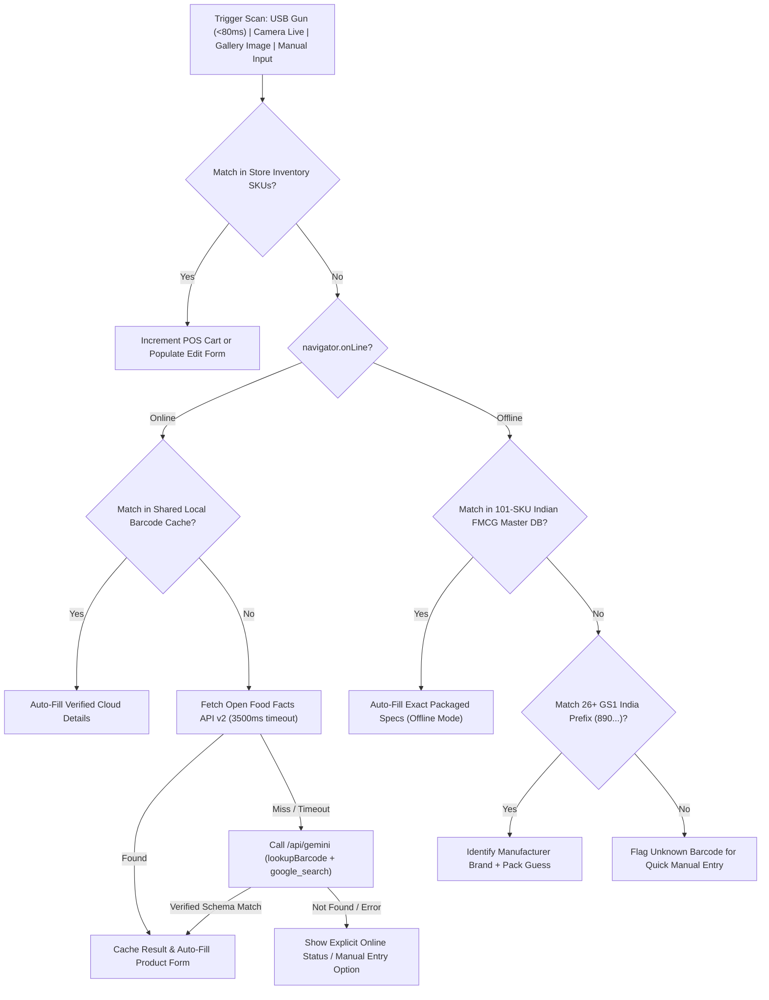
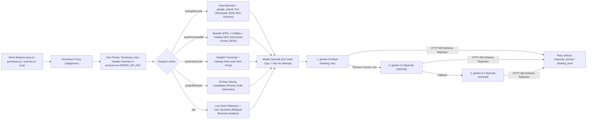
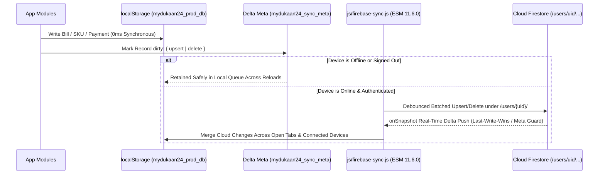

<div align="center">



<br />
<br />

# 📖 The MyDukaan24 Book

### *Architectural Blueprint, Field Manual & Hackathon Engineering Compendium for India's Hybrid Retail Business OS*

[](https://mydukaan-eta.vercel.app/app.html)
[](#-chapter-viii-offline-first-dual-persistence-firebase-auth--zero-leak-security)
[](#-chapter-vii-gemini-38-interactions-api--dukaan-copilot)
[](#-chapter-i-system-architecture--infrastructure-blueprint)
[](#-chapter-ix-responsive-design-system--multilingual-engine)

<br />

**[🚀 Live Web Terminal (`app.html`)](https://mydukaan-eta.vercel.app/app.html)** · **[🌐 Product Landing & Sandbox (`index.html`)](https://mydukaan-eta.vercel.app/)** · **[⚡ Netlify Mirror](https://mydukaan24.netlify.app/)** · **[💻 Source Repository](https://github.com/mayursingh24/MyDukaan)**

</div>

---

> *"Walk into any neighborhood Kirana store at 8:00 PM in India: three customers are holding milk crates and spice packets, one regular asks to put a ₹240 bill on monthly Udhaar, a wholesaler drops off a crumpled handwritten invoice, and broadband connectivity flickers inside the concrete shop. Enterprise ERPs choke on latency and complexity; paper ledgers leak revenue every single day. **MyDukaan24** bridges that divide in a single zero-build web operating system."*

---

## 📑 Table of Contents

- [Author & Hackathon Dossier](#-author--hackathon-dossier)
- [Prologue: The Problem Statement & Field Reality](#-prologue-the-problem-statement--field-reality)
- [Chapter I: System Architecture & Infrastructure Blueprint](#-chapter-i-system-architecture--infrastructure-blueprint)
- [Chapter II: Visual UI/UX Showcase — Desktop & Mobile Tour](#-chapter-ii-visual-uiux-showcase--desktop--mobile-tour)
- [Chapter III: The Core Billing Loop — POS, Loose Weights, Voice & Held Queue](#-chapter-iii-the-core-billing-loop--pos-loose-weights-voice--held-queue)
- [Chapter IV: Universal Barcode Vision & Strict Online vs. Offline Resolution](#-chapter-iv-universal-barcode-vision--strict-online-vs-offline-resolution)
- [Chapter V: Inventory Safety, Expiry Radar, Bulk CSV & Wholesale Ledger](#-chapter-v-inventory-safety-expiry-radar-bulk-csv--wholesale-ledger)
- [Chapter VI: Udhaar Khata, Staff RBAC, Cash Register & GSTR-1 / TallyPrime](#-chapter-vi-udhaar-khata-staff-rbac-cash-register--gstr-1--tallyprime)
- [Chapter VII: Gemini 3.8 Interactions API & Dukaan Copilot](#-chapter-vii-gemini-38-interactions-api--dukaan-copilot)
- [Chapter VIII: Offline-First Dual Persistence, Firebase Auth & Zero-Leak Security](#-chapter-viii-offline-first-dual-persistence-firebase-auth--zero-leak-security)
- [Chapter IX: Responsive Design System & Multilingual Engine](#-chapter-ix-responsive-design-system--multilingual-engine)
- [Chapter X: Deployment Playbook, Shortcuts & Repository Map](#-chapter-x-deployment-playbook-shortcuts--repository-map)
- [License & Attribution](#-license--attribution)

---

## 👨‍💻 Author & Hackathon Dossier

| Attribute | Project Detail |
| :--- | :--- |
| **Platform** | **MyDukaan24 (`v9.0`)** — Retail Business Operating System & Smart POS |
| **Author** | **Mayur Singh** |
| **Engineering Hub** | Lucknow, Uttar Pradesh, India |
| **Primary Deployment** | Vercel Edge + Serverless Functions (`https://mydukaan-eta.vercel.app`) |
| **Secondary Mirror** | Netlify Static + Functions (`https://mydukaan24.netlify.app`) |
| **Public Profiles** | [GitHub (`mayursingh24/MyDukaan`)](https://github.com/mayursingh24/MyDukaan) · [LinkedIn (`mayursingh24`)](https://linkedin.com/in/mayursingh24) |

---

## 📜 Prologue: The Problem Statement & Field Reality

India's neighborhood retail backbone—over 12 million independent Kirana stores, mini-supermarkets, and departmental outlets—operates under uniquely demanding constraints that Western cloud POS suites fail to address:

| Real-World Shop Floor Pain Point | How Paper / Legacy Tools Fail | How MyDukaan24 Solves It (`v9.0`) |
| :--- | :--- | :--- |
| **Evening Rush Queue Bottlenecks** | Calculator mistakes, typing sluggishness, waiting for one indecisive shopper blocks everyone behind them. | Sub-second POS billing with `Ctrl+K` / `F2`, hardware scanner-gun capture (`<80ms` keystroke detector), loose-weight chips (`250g/500g/1kg/1.5kg/2kg`), and **Held Cart Queue (up to 25 parked bills)**. |
| **Fractional Loose-Commodity Pricing** | Sugar, Dal, Rice, and Cooking Oil sell in fractional weights (`0.25kg`, `1.5kg`, `0.5L`), causing manual math errors. | Decimal-precision quantities (`step="0.05"`), one-tap fractional chips, and offline Hinglish voice parsing (`"dedh kilo chini"`, `"aadha litre oil"`). |
| **Unrecovered Udhaar Credit Leakage** | Dog-eared notebooks lose pages, balances go uncollected, and shopkeepers hesitate to remind customers awkwardly. | Dedicated **Udhaar Khata CRM** with per-customer ledger history and 1-click formatted WhatsApp payment reminders with store UPI details. |
| **Silent Shelf Expiry & Over/Under-Buying** | Milk, curd, bread, and packaged snacks expire unnoticed while staples unexpectedly hit zero mid-weekend. | Active **Expiry Radar** (`Expired`, `Today`, `<= 7 Days`, `<= 30 Days`) plus a **30-Day Velocity Auto-Restock Engine** calculating exact `daysLeft` and recommended reorder quantities. |
| **Slow Wholesaler Restock Data Entry** | Entering 30–60 line items from a distributor's printed/handwritten invoice takes 20 minutes after closing time. | **AI Purchase Bill Scanner** compresses an invoice photo to `1280px` JPEG client-side, extracts all SKUs via **Gemini Vision**, maps existing products, and increments stock in one confirmation click. |
| **GST Compliance & TallyPrime Exports** | Manual slab summation across 0%, 5%, 12%, and 18% GST and adjusting credit notes for returned items is error-prone. | Live return-adjusted **GSTR-1 slab table**, downloadable **GSTR-1 CSV**, printable **GST Filing PDF**, and standard **TallyPrime XML Sales Vouchers**. |
| **Shop Internet Dropouts & Multi-Staff Risk** | Cloud-only SaaS freezes completely when mobile data drops; sharing one login exposes net profit margins to helpers. | **0ms offline local engine** + background **Cloud Firestore multi-tab sync** + **Owner vs. Cashier RBAC** with PIN lock so cashiers only access Billing, Scanner, and Stock views. |

### Interactive Entry Experience (`index.html`)

Before even signing into a private store workspace, visitors and hackathon judges can test a live interactive counter simulator, explore dual-mode AI capabilities, or authenticate via Firebase Google / Email sign-in right from the landing experience.

<div align="center">


*Figure 0.1 — Production Landing Hero (`index.html`): Dark Obsidian aesthetic, MD24 Cloud Core live telemetry panel, direct Cloud Auth CTA, and interactive terminal trigger.*

<br />


*Figure 0.2 — Live Landing Simulator (`index.html`): Real-time cart calculations, laser scan chime simulation, live Gemini `/api/gemini` connection status, and instant `80mm` receipt preview.*

</div>

---

## 🏛️ Chapter I: System Architecture & Infrastructure Blueprint

### Zero-Build Architecture Philosophy

MyDukaan24 was deliberately architected as a **zero-build ES6+ web application** (`no bundler`, `no React hydration delay`, `no node_modules client tax`). Every JavaScript module loads natively via standard browser scripts over HTTP/2, assets precache via a clean Network-First Service Worker (`sw.js`, cache namespace `mydukkan24-v9.1`, **24 precached core files**), and serverless compute runs only when live Gemini AI calls are dispatched.

### High-Level Architecture Diagram



### Technology Matrix

| Layer | Implementation Details | Source Files |
| :--- | :--- | :--- |
| **Application Shell** | Semantic HTML5 (`index.html`, `app.html`), PWA Manifest (`manifest.json`), Network-First Service Worker (`v9.1`) | [`index.html`](index.html), [`app.html`](app.html), [`sw.js`](sw.js) |
| **Design & Layout** | Custom CSS Variables Dark (`#070913` / `#131A2D`) & Light themes, Inter + JetBrains Mono, strict `min-width: 0` grids | [`css/style.css`](css/style.css), [`css/components.css`](css/components.css), [`css/landing.css`](css/landing.css) |
| **Offline Database** | Synchronous `localStorage` store (`mydukaan24_prod_db`), sync delta log (`mydukaan24_sync_meta`), JSON export/restore | [`js/storage.js`](js/storage.js) |
| **Cloud Sync & Auth** | Dynamic Firebase SDK `11.6.0` ESM, Google + Email Auth, `persistentLocalCache` + `persistentMultipleTabManager` | [`js/firebase-sync.js`](js/firebase-sync.js), [`firestore.rules`](firestore.rules) |
| **Vision & Scanning** | Hardware USB/Bluetooth keyboard-wedge capture + `Html5Qrcode` (`fps: 20`) + `BarcodeDetector` + 101-SKU DB | [`js/scanner.js`](js/scanner.js), [`js/html5-qrcode.min.js`](js/html5-qrcode.min.js) |
| **Serverless AI** | Unified Node.js handler targeting Gemini `v1beta/interactions` (`21s` hard budget, schema & search grounding) | [`api/gemini.js`](api/gemini.js), [`netlify/functions/gemini.js`](netlify/functions/gemini.js) |
| **Localization & SVG** | Zero-dependency inline SVG registry + instant runtime translations in **English**, **हिन्दी**, and **Hinglish** | [`js/icons.js`](js/icons.js), [`js/i18n.js`](js/i18n.js) |

---

## 🖼️ Chapter II: Visual UI/UX Showcase — Desktop & Mobile Tour

Every screenshot below was captured live from the production deployment (`mydukaan-eta.vercel.app`) using sanitized demo shop data (`MyDukaan24 Demo Mart`).

### 1. Executive Dashboard — Live Pulse, Expiry & Restock Radar

At a glance, the store owner sees today's net billed revenue, pending customer Udhaar balances, low-stock & expiring-soon product counts, rounded cost valuation, live transaction history with return indicators, and AI-prioritized reorder recommendations.


*Figure 2.1 — Executive Dashboard (`1440×900`): Critical Expiry Alert (`<= 7 Days`), Low Stock alert banner, KPI cards, Recent Sales Transactions (`INV-1001`, `INV-1002`), and Smart Auto-Restock AI advisor.*

---

### 2. High-Speed POS Billing Terminal — Loose Weights, Hold Queue & Multi-Tender

Designed for three-second checkouts: tap any item, choose fractional loose-weight chips (`250g`, `500g`, `1kg`, `1.5kg`, `2kg`), park an interrupted shopper into the `Queue` via `Hold`, trigger Hindi/Hinglish `Voice` billing, apply percentage/flat discounts, and settle across Cash (`F8`), Dynamic UPI QR (`F9`), Card, or Udhaar (`F10`).


*Figure 2.2 — POS Billing Terminal (`1440×900`): Active cart featuring loose-weight Basmati Rice chips (`1kg` selected), GST 5% calculation, held queue badge (`Queue 1`), MRP savings summary, and rapid Cash denomination keys.*

---

### 3. Products & Stock Safety — Expiry Badges, Valuations & Bulk CSV

Tracks cost price vs. MRP vs. selling price per SKU, flags dairy and FMCG batches expiring within days (`Expiring in 6d`, `Expiring in 4d`), supports one-click `Import CSV` for onboarding 500+ items at once, and opens the `Smart Restock AI` panel.


*Figure 2.3 — Products & Stock Management (`1440×900`): Cost vs. Retail inventory asset valuation (`₹27,184` vs `₹32,758`), active expiry status badges, barcode column, and quick inline stock adjustments.*

---

### 4. Financial Analytics, Real P&L & GSTR-1 / TallyPrime Compliance

Computes live SVG revenue trajectories across `Today`, `7 Days`, `This Month`, and `All Time`, strips out sales returns/refunds and COGS cleanly before subtracting store expenses for true **Net Take-Home Profit**, and builds a return-adjusted **GSTR-1 Tax Liability Table** exportable as CSV, PDF, or **TallyPrime XML**.


*Figure 2.4 — Reports & P&L + GST Filing (`1440×900`): 7-Day Real Revenue Curve, Net Take-Home Profit breakdown, and slab-wise `0% / 5% / 12% / 18%` GSTR-1 summary with `GSTR-1 CSV`, `Tally XML`, and `Print GST PDF` actions.*

---

### 5. Wholesale Purchases & AI Distributor Bill OCR

Tracks supplier invoices, credit payables, and vendor directories. Photographing a paper distributor bill via `Scan Bill Photo (AI)` parses invoice headers and line items via Gemini Vision, while paying off a balance automatically reconciles open supplier bills chronologically in FIFO order.


*Figure 2.5 — Wholesale Purchases & Supplier Ledger (`1440×900`): AI invoice photo scanner button, inward bills ledger, pending supplier payables (`₹6,300`), and Supplier Master Directory with FIFO `Pay Balance` settlement.*

---

### 6. Dukaan Copilot AI — Live Store-Grounded Reasoning

Dukaan Copilot receives live store inventory levels, expiring batches, low-stock counts, customer debtor standings, and sales metrics dynamically via `/api/gemini` when online, or pivots cleanly to its built-in rule engine when offline.


*Figure 2.6 — Dukaan Copilot Modal: Connected directly to Gemini Interactions API with one-click prompts for Low Stock Alerts, Top Debtors, Store Health Summary, and Profit Margin tuning.*

---

### 7. Pocket Retail Experience (`390×844` Mobile POS)

Built for shop owners walking the aisles or managing deliveries from their phone: collision-free mobile header (`⚡ Sale`, quick notification badge, Copilot button), voice/camera scan buttons, 0px horizontal overflow, bottom sticky cart bar, and thumb-friendly dock.

<div align="center">


*Figure 2.7 — Mobile POS (`390×844`): Responsive layout with closed drawer, floating sticky cart summary (`Cart: 2 items · ₹282.75 · View Bill →`), and bottom dock navigation.*

</div>

---

## ⚡ Chapter III: The Core Billing Loop — POS, Loose Weights, Voice & Held Queue

The POS engine in [`js/pos.js`](js/pos.js) is built around real Indian counter workflows where speed, fractional weights, interrupted queues, and flexible settlements determine customer throughput.

### POS Checkout & Settlement Lifecycle



### Detailed Sub-Systems in `js/pos.js`

1. **Smart Weight Chips & Decimal Math:**
   - `isWeightUnit(unit)` inspects product units automatically:
     - Weight/Bulk units (`kg`, `kilogram`, `kgs`, `gm`, `g`, `bag`, `loose`): renders quick preset chips `250g (0.25)`, `500g (0.5)`, `1kg (1)`, `1.5kg (1.5)`, `2kg (2)`.
     - Liquid units (`l`, `ltr`, `litre`, `liter`, `ml`): renders `250ml (0.25)`, `500ml (0.5)`, `1L (1)`, `1.5L (1.5)`, `2L (2)`.
     - Pack/Unit fallback: renders `0.5`, `1`, `2`, `5` plus custom keyboard input at `0.05` step precision.
   - Cart item blocks wrap cleanly via `.cart-item-block`, `.cart-item-row`, and `.weight-chips-row` so controls remain finger-friendly on mobile while staying compact on desktop.

2. **Multi-Customer Held / Parked Queue:**
   - Clicking **Hold** stores the active cart, customer selection, discount metadata, timestamp, and item preview into `db.parkedCarts` (capped at `25` simultaneous held orders).
   - Clicking **Queue (N)** opens the parked-cart drawer. Resuming a parked bill automatically parks the current non-empty cart first (zero accidental bill loss) and clamps resumed quantities against real-time remaining stock.

3. **Hindi & Hinglish Voice Billing:**
   - Supports browser `SpeechRecognition` / `webkitSpeechRecognition` (`hi-IN` and `en-IN`).
   - **Online:** Dispatches spoken transcript + product catalog hints to Gemini `parseVoiceCart` (`/api/gemini`) for natural-language matching and unit normalization.
   - **Offline Fallback (`parseVoiceOfflineHinglish`):** Parses spoken Indian numerals and fractional words deterministically: `ek` (1) through `das` (10), `aadha` (`0.5`), `pav` (`0.25`), `sawa` (`1.25`), `dedh` (`1.5`), `dhai` (`2.5`), matching tokens directly against active store SKUs.

4. **Four Settlement Channels & UPI QR:**
   - **Cash (`F8`):** Instant tendered presets (`+₹100`, `+₹200`, `+₹500`, `Exact`) with real-time change-to-return display.
   - **Dynamic UPI QR (`F9`):** Renders an instant scannable QR code (`upi://pay?pa=<your-store-upi>&pn=<shop-name>&am=<total>&cu=INR`) compatible with PhonePe, Google Pay, Paytm, and BHIM.
   - **Card & Digital Udhaar (`F10`):** Validates a real named customer (blocking anonymous Walk-In credit) before incrementing customer Khata dues.

5. **Sales Returns, Partial Refunds & Thermal Receipts:**
   - Sales Ledger allows partial or full item returns (`returnedQty`, `returnedItems`), automatically crediting returned quantities back into product inventory and updating net revenue/COGS/GST across Dashboard and Reports.
   - Generates print-ready **58mm (`52mm` printable CSS width)** and **80mm (`72mm` printable CSS width)** itemized thermal receipts with CGST/SGST splits, MRP savings callout, and 1-click WhatsApp digital invoice dispatch.

---

## 📷 Chapter IV: Universal Barcode Vision & Strict Online vs. Offline Resolution

[`js/scanner.js`](js/scanner.js) enforces a strict isolation rule: **live network mode never silently impersonates data using offline guesses, and offline mode never fails on missing internet.**

### Barcode Resolution Decision Pipeline



### Engine Technical Highlights

- **Hardware Keyboard-Wedge Gun Listener:** Attaches a global `keydown` monitor that buffers rapid keystrokes arriving under `diff < 80ms` apart (outside form inputs) and triggers scan lookup automatically when `Enter` arrives with `buffer.length >= 4`.
- **Dual Camera Pipeline:** Pairs the bundled offline [`js/html5-qrcode.min.js`](js/html5-qrcode.min.js) (`fps: 20`, experimental `BarcodeDetector` enabled, plus `scanFileV2` for uploading product/barcode photos) with a pure native `BarcodeDetector` fallback (`ean_13`, `ean_8`, `upc_a`, `upc_e`, `code_128`, `code_39`, `qr_code`, `itf`) and interactive torch/camera selection.
- **Built-in Knowledge Base:** Ships with **101 pre-mapped Indian FMCG SKUs** in `BarcodeScanner.FMCG_MASTER_DB` (Aashirvaad, Fortune, Amul, Tata Tea, Maggi, Parle-G, Surf Excel, Dettol, Dairy Milk, Haldiram's, Colgate, Nescafé, Bisleri, Red Bull, etc.) and **26 GS1 Manufacturer Prefixes** (`8901030` HUL, `8901058` Nestlé India, `8901063` Britannia, `8901262` Amul/GCMMF, `8901491` Haldiram's, `8901725` ITC, `8901719` Parle, etc. plus generic `890` Indian FMCG identification).

---

## 📦 Chapter V: Inventory Safety, Expiry Radar, Bulk CSV & Wholesale Ledger

[`js/inventory.js`](js/inventory.js) and [`js/purchases.js`](js/purchases.js) manage the supply side—preventing dead capital, spoilage, and distributor ledger disputes.

### 1. Expiry Date Radar

Every SKU supports an optional `expiryDate` (`YYYY-MM-DD`). Both the Dashboard and Inventory screen evaluate days remaining relative to midnight local time:
- `< 0 days`: **`Expired`** (`badge-danger`)
- `0 days`: **`Expires Today!`** (`badge-danger`)
- `1–7 days`: **`Expiring in Xd`** (`badge-warning`) — triggers the top red Dashboard Expiry Alert banner
- `<= 30 days` & `> 30 days`: **`Exp: Date`** (`badge-muted`)

### 2. Bulk CSV / TSV Onboarding Engine (500+ Rows)

Built for shopkeepers migrating from Excel or Busy/Marg spreadsheets:
- Auto-strips UTF-8 BOM (`\uFEFF`) and automatically detects tab-delimited Excel pastes (`\t`) vs. standard comma-separated CSV (`,`), handling quoted strings cleanly.
- Normalizes flexible header aliases (`name`, `product`, `sku`, `barcode`, `category`, `cost`, `mrp`, `price`, `stock`, `qty`, `unit`, `gst`, `minStock`, `expiryDate`).
- **Upsert Logic:** Matches incoming rows by Barcode first, then case-insensitive Product Name; updates pricing/stock cleanly on existing SKUs or mints fresh `P1xx` SKUs on new rows. Downloadable template included inside the modal.

### 3. 30-Day Sales Velocity & Demand Forecaster

When the shop is offline—or before firing an online Gemini forecast—the inventory engine inspects the last 30 days of `invoices`, accurately **subtracting any `returnedItems`** per product to find true net consumption:

$$\text{dailyVelocity} = \frac{\text{netSold}_{30\text{d}}}{30}, \qquad \text{daysLeft} = \frac{\text{stock}}{\text{dailyVelocity}}$$

$$\text{targetBuffer} = \max\Big(2 \times \text{minStock},\ \big\lceil 14 \times \text{dailyVelocity} \big\rceil\Big)$$

$$\text{suggestedOrderQty} = \max\big(0,\ \text{targetBuffer} - \text{stock}\big)$$

Items trigger restock priority alerts whenever `stock <= minStock` or `daysLeft <= 7`. When online, clicking **Smart Restock AI** enriches these velocity stats through Gemini `predictRestock` for supplier-ready purchase advisories.

### 4. Wholesale Purchases, Vision Invoice OCR & FIFO Settlement

- **AI Bill Photo Scanner (`js/purchases.js`):** Accepts any phone camera shot or gallery image of a distributor invoice, scales & compresses it client-side on an offscreen `<canvas>` (`maxDim = 1280px`, `image/jpeg`, `0.82` quality) so serverless payloads remain lightweight (~150–300 KB), and sends it along with up to `180` compact `catalogHints` to `/api/gemini` (`scanPurchaseBill`).
- **Line-Item Auto-Reconciliation:** Matches extracted invoice descriptions via word-overlap scoring against existing store SKUs (or tags brand-new goods as `__NEW__`), lets the owner inspect/tweak quantities, cost rates, and MRP/selling prices, and atomically records the supplier bill while incrementing SKU stock.
- **FIFO Credit Settlement:** Calling `saveSupplierPayment(supplierId)` automatically settles pending inward purchase bills **chronologically by ascending bill date (`FIFO`)**, updating each purchase bill's `paidAmount`, `dueAmount`, and `status` (`Paid` / `Partial` / `Due`).

---

## 🤝 Chapter VI: Udhaar Khata, Staff RBAC, Cash Register & GSTR-1 / TallyPrime

### 1. Customer Udhaar Khata (`js/khata.js`)

Maintains running credit balances per customer with full transaction logs (`credit` invoices vs. `payment` collections). Supports partial settlements, quick ledger drill-downs, and one-click formatted WhatsApp payment requests displaying outstanding balance and your configured store UPI ID.

### 2. Owner vs. Cashier Role-Based Access Control (RBAC)

Real stores rarely leave the owner glued to the billing counter 14 hours a day. MyDukaan24 implements clean device-level RBAC inside [`js/app.js`](js/app.js):
- **Owner Mode:** Full access to all 11 views — Executive Dashboard, POS Billing, Scanner, Products & Stock (create/edit/delete/import/export), Product Catalog, Wholesale Purchases, Udhaar Khata, Customers, Sales Ledger (with returns), Daily Expense Tracker, Financial Reports & P&L / GST Exports, Staff & Attendance, Store Settings, Backup/Restore, and Firebase Cloud Sync controls.
- **Cashier Mode:** Navigation locks strictly to **`cashierAllowedPages: ['pos', 'scanner', 'inventory', 'catalog']`**, hides purchase cost prices/margins/delete actions in inventory, masks Store Settings & P&L analytics, and requires the configured **Owner PIN** to elevate back to Owner Mode.

### 3. Daily Expense Tracker, Z-Report (`F4`) & 31-Day Staff Payroll

- **Cash Drawer & Z-Report (`F4`):** Computes Opening Float + Cash Sales − Cash Refunds − Cash Expenses vs. digital UPI/Card collections, with printable end-of-day Z-Report reconciliation sheets.
- **Daily Expense Tracker:** Logs Rent, Electricity, Logistics, Staff Advances, Tea/Snacks, and Store Maintenance so owner profit numbers reflect reality—not vanity top-line GMV.
- **Staff Directory & Attendance (`js/staff.js`):** Interactive 31-day grid tracking Present (`P`), Half-Day (`H`), and Absent (`A`) marks per employee with automated prorated salary estimation (`earned = baseSalary * (present + 0.5 * half) / workingDays`).

### 4. Return-Adjusted P&L & GSTR-1 / TallyPrime Accounting (`js/analytics.js`)

For every invoice across `Today` (Morning/Afternoon/Evening/Night buckets), `7 Days`, `This Month` (4 weekly buckets), and `All Time` (monthly `YYYY-MM` series), financial computations adjust proportionally for any refunds or partial sales returns:

$$\text{invRatio} = \frac{\max(0,\ \text{invoice.total} - \text{refundAmount})}{\max(0.01,\ \text{invoice.total})}$$

$$\text{Net Take-Home Profit} = \big(\text{Gross Billed Revenue} - \text{Sales Returns}\big) - \text{Net COGS} - \text{Operating Expenses}$$

For **GSTR-1 Tax Slabs (`0%`, `5%`, `12%`, `18%`)**:
- Net line totals and GST amounts account directly for `returnedItems` and scale cleanly via `invRatio`.
- Splits GST evenly into intra-state components: `CGST = round2(totalTax / 2)` and `SGST = round2(totalTax - CGST)` (eliminating rounding drift to the paisa).
- Exports:
  1. **GSTR-1 Tax Summary + B2C Invoice CSV** (Excel/GST portal ready)
  2. **Printable GST Filing PDF Report** (with Store GSTIN header `gstin` and slab-by-slab totals)
  3. **TallyPrime XML Voucher Import** (`<ENVELOPE><HEADER><TALLYREQUEST>Import Data</TALLYREQUEST></HEADER><BODY><IMPORTDATA><REQUESTDESC><REPORTNAME>Vouchers</REPORTNAME></REQUESTDESC><REQUESTDATA><TALLYMESSAGE><VOUCHER VCHTYPE="Sales">...</VOUCHER></TALLYMESSAGE></REQUESTDATA></IMPORTDATA></BODY></ENVELOPE>`) ready for TallyPrime / Tally.ERP 9 ingestion.

---

## 🤖 Chapter VII: Gemini 3.8 Interactions API & Dukaan Copilot

Both [`api/gemini.js`](api/gemini.js) (Vercel) and [`netlify/functions/gemini.js`](netlify/functions/gemini.js) (Netlify) implement a unified serverless gateway targeting Google's modern **Interactions API**.

### Serverless Proxy Flow



### Key Architectural Guarantees

- **Modern Endpoint & Headers:** Calls `POST https://generativelanguage.googleapis.com/v1beta/interactions` with `Api-Revision: 2026-05-20` and `x-goog-api-key`, supporting both **`AQ...`** and **`AIzaSy...`** Google AI Studio key formats.
- **Resilient Response Unpacking:** Handles all Interactions API output layouts seamlessly—top-level `output_text`, multi-step `steps[]` containing `model_output`, `outputs[]` content blocks, and legacy `candidates[]` envelopes.
- **Zero-Leak API Key Discipline:** Browser-local keys stored via the UI **`🔑 Key`** modal remain strictly in browser `localStorage` and are explicitly **blocked from leaving the device to Firestore** by `firestore.rules`.

---

## 🔥 Chapter VIII: Offline-First Dual Persistence, Firebase Auth & Zero-Leak Security

Designed by [`js/storage.js`](js/storage.js), [`js/firebase-sync.js`](js/firebase-sync.js), and [`firestore.rules`](firestore.rules) so single-device offline shops and multi-terminal cloud shops share one codebase cleanly.

### Offline-to-Cloud Reconciliation Architecture



### Data Isolation & Firestore Rules Schema (`firestore.rules`)

All cloud records reside inside strictly partitioned per-UID subcollections—zero shared global tables, zero cross-store queries, and default deny at root and fallback catch-all levels:

| Firestore Document Path | Guarded Fields & Validation Constraints |
| :--- | :--- |
| `/users/{uid}/meta/store` | Store metadata (`name`, `owner`, `gstin`, `upiId`, `invoicePrefix`); **strictly forbids `'geminiKey' in shop`** (`!hasGeminiKey`) |
| `/users/{uid}/products/{productId}` | Immutable `id == productId`, `name` size bounds (`1..200`), non-negative numbers (`mrp >= 0`, `price >= 0`, `cost >= 0`, `stock >= 0`, `gst <= 100`) |
| `/users/{uid}/customers/{customerId}` | Immutable `id == customerId`, `due >= 0`, string length bounds |
| `/users/{uid}/invoices/{invoiceId}` | Immutable `id == invoiceId`, valid totals (`total >= 0`, `discount >= 0`), supports `returnedItems` & refunds |
| `/users/{uid}/suppliers/{supplierId}` | Immutable `id == supplierId`, vendor master metadata (`<= 12` fields validated) |
| `/users/{uid}/purchases/{purchaseId}` | Immutable `id == purchaseId`, inward bill totals & FIFO payment tracking |
| `/users/{uid}/expenses/{expenseId}` | Immutable `id == expenseId`, expense amount `>= 0` & category bounds |
| `/users/{uid}/staff/{staffId}` | Immutable `id == staffId`, salary `>= 0` & attendance records |
| `/users/{uid}` & `/{document=**}` | **Explicit `allow read, write: if false;`** — prevents enumeration or writes outside approved paths |

> **7 Synchronized Collections:** `products`, `customers`, `invoices`, `suppliers`, `purchases`, `expenses`, and `staff` (`SYNC_CATEGORIES`) synchronize continuously alongside `meta/store`.

---

## 📱 Chapter IX: Responsive Design System & Multilingual Engine

### Visual Language & Theme System

- **Dark Mode Palette:** Deep Obsidian canvas (`#070913`), Elevated Solid Card surfaces (`#131A2D`), Luminous Cobalt (`#3B82F6`), Emerald Profit (`#10B981`), Amber Warning (`#F59E0B`), Crimson Expiry/Due (`#EF4444`).
- **Light Mode Parity:** Complete CSS custom property overrides across cards, charts, inputs, thermal receipts, and the mobile bottom dock.
- **Zero-Icon-Font Overhead:** Custom inline SVG registry in [`js/icons.js`](js/icons.js) guarantees pixel-crisp vector strokes even offline before Google Fonts load.

### Viewport Engineering & Z-Index Stack (`320px` to `1920px+`)

- **Desktop Topbar Compaction (`css/style.css`):** Progressive media rules at `@media (min-width: 901px) and (max-width: 1520px)`, `1360px`, and `1140px` gracefully scale search bar flex widths (`flex: 1 1 180px`, `max-width: 240px -> 195px -> 150px`), hide `.hide-tablet`, and constrain chip padding so topbar search never collides with language or Role pills.
- **Mobile Breakpoints:** Adaptive grid compaction across `<= 1024px`, `900px` (collapses desktop sidebar into slide-over drawer + reveals fixed mobile bottom nav), `768px`, `640px`, `440px` (`⚡ New Sale` shortens cleanly to `⚡ Sale`), and `350px` using `overflow-x: clip`, explicit `min-width: 0`, and `.hide-mobile-col` table rules.

| Layer Component | CSS `z-index` | Purpose |
| :--- | :---: | :--- |
| **Sticky Mobile POS Cart Bar** | `9980` | Persistent mobile checkout bar showing live item count & payable total |
| **Slide-Up POS Cart Drawer** | `9985` | Expandable mobile cart sheet above bottom controls |
| **Mobile Bottom Navigation Dock** | `9990` | Fixed quick tabs (`Home`, `Billing`, `Scan`, `Stock`, `Khata`, `Settings`) |
| **Sidebar Backdrop & Slide Drawer** | `10005` – `10010` | Off-canvas navigation + language switcher + Z-report drawer |
| **Scrollable Modal Overlays** | `10020` | Product editor, Purchase OCR, Copilot chat, Settings & Backup modals |
| **Live Camera Barcode Scanner** | `10030` | Fullscreen viewport finder (`Html5Qrcode` + torch toggle) |
| **Toast Notifications & Alerts** | `10050` | Topmost transient confirmation & error notifications |

### Instant Runtime Multilingual Engine (`js/i18n.js`)

Shop owners and cashiers switch live with zero reload across:
- **English** — Full retail & accounting terminology
- **हिन्दी (Hindi)** — Native Devanagari interface for local counter operators
- **Hinglish** — Natural everyday Indian retail vocabulary (`Udhaar Khata`, `Stock Alert`, `Bill Banao`)

---

## 🚀 Chapter X: Deployment Playbook, Shortcuts & Repository Map

### 1. Deploy Your Own Instance on Vercel (Recommended)

1. Push/fork `mayursingh24/MyDukaan` on GitHub.
2. Import the repository into [vercel.com/new](https://vercel.com/new), keep **Framework Preset: Other** and leave Output Directory empty (static root + `api/` serverless functions configured via [`vercel.json`](vercel.json)).
3. Open **Project Settings ➔ Environment Variables** and add:
   - **Key:** `GEMINI_API_KEY` *(supports `AQ...` and `AIzaSy...` keys from [Google AI Studio](https://aistudio.google.com/api-keys))*
   - **Environments:** Production, Preview, Development
4. Trigger a **Redeploy** so [`api/gemini.js`](api/gemini.js) loads the active secret.
*(Netlify Alternative: Import repo on Netlify; [`netlify.toml`](netlify.toml) + [`_redirects`](_redirects) wire `/api/gemini` to [`netlify/functions/gemini.js`](netlify/functions/gemini.js). You can turn off the floating Netlify badge under Project Configuration ➔ General ➔ Site details.)*

### 2. Activate Firebase Authentication & Cloud Firestore (Spark Free Plan)

1. Open [Firebase Console](https://console.firebase.google.com/) and open/create your project.
2. **Authentication:** Go to **Build ➔ Authentication ➔ Get started ➔ Sign-in method** and enable **Google** and **Email/Password**.
3. **Authorized Domains:** Under **Authentication ➔ Settings ➔ Authorized domains**, add your deployed domain (e.g., `mydukaan-eta.vercel.app`, plus `localhost` for local testing).
4. **Cloud Firestore:** Under **Build ➔ Firestore Database**, create your `(default)` database in **Standard Edition**.
5. **Security Rules:** Open the **Rules** tab, paste the exact contents of [`firestore.rules`](firestore.rules), and click **Publish** (or deploy via `npx -y firebase-tools@latest deploy --only firestore`).
6. **Connect Store:** Sign in directly via **`Sign In / Join`** on [`index.html`](index.html) or open **Store Settings ➔ Firebase Cloud Sync** inside [`app.html`](app.html).

### 3. Installing as a Mobile / Desktop PWA vs. Android APK Note

- **Recommended Install Path (Live PWA):** Open [`https://mydukaan-eta.vercel.app/`](https://mydukaan-eta.vercel.app/) in Chrome/Edge (Android, Windows, macOS) or Safari (iOS) and tap **Add to Home Screen / Install App**. Service Worker `v9.1` precaches all **24 core runtime files** for instant offline launches.
- **Note on `assets/MyDukkan24-v4.apk`:** The file in [`assets/MyDukkan24-v4.apk`](assets/MyDukkan24-v4.apk) is a lightweight packaging stub included for landing-page download flow testing; for active daily counter operations on Android devices, use the installed **PWA** (`app.html`), which automatically receives live cloud & Service Worker updates.

### 4. Power-User Keyboard Shortcuts

| Shortcut | Terminal Action |
| :---: | :--- |
| **`Ctrl + K`** | Focus global item & barcode command search bar |
| **`F2`** | Switch straight to POS Billing counter |
| **`F3`** | Launch Universal Barcode Scanner modal |
| **`F4`** | Open Daily Cash Register & Day-End Z-Report |
| **`F8`** | Select **Cash** tender inside POS checkout |
| **`F9`** | Select **Dynamic UPI QR** tender inside POS checkout |
| **`F10`** | Select **Udhaar Credit** tender inside POS checkout |
| **`Esc`** | Close active modal overlay, cart drawer, or scanner |
| **USB / BT Gun** | Auto-captures fast keystrokes (`<80ms`) ending in `Enter` from anywhere |

### 5. Verified Repository Structure

```text
MyDukaan-v4/
├── api/
│   └── gemini.js                  # Vercel Serverless Gemini Interactions API v1beta proxy
├── assets/
│   ├── LOGO.jpeg                  # Brand raster mark
│   ├── logo.svg                   # Crisp vector store icon
│   └── MyDukkan24-v4.apk          # Landing download package stub (use PWA for live Android)
├── css/
│   ├── components.css             # POS cards, weight chips, Khata, scanner & mobile dock
│   ├── landing.css                # SaaS landing hero, live simulator & Firebase auth modal
│   └── style.css                  # Design tokens, dark/light themes, z-index & breakpoints
├── docs/
│   └── images/
│       ├── 00-book-cover.jpg      # MyDukaan24 Book Showcase Cover
│       ├── 01-landing-hero.png    # Production hero & Cloud Core status panel
│       ├── 02-landing-sandbox.png # Interactive browser POS simulator
│       ├── 03-dashboard.png       # Executive dashboard, expiry & AI restock radar
│       ├── 04-pos-terminal.png    # POS counter with loose weights & held queue
│       ├── 05-inventory-expiry.png# Inventory management, valuation & expiry alerts
│       ├── 06-reports-gst-tally.png# P&L curve, GSTR-1 slabs & TallyPrime export
│       ├── 07-purchases-ai-ocr.png# Wholesale supplier ledger & AI Bill Photo scanner
│       ├── 08-ai-copilot.png      # Dukaan Copilot modal (Gemini Interactions API)
│       └── 09-mobile-pos.png      # 390x844 zero-overflow mobile counter UI
├── js/
│   ├── ai.js                      # Dukaan Copilot client (Strict Online API vs Offline Engine)
│   ├── analytics.js               # Real P&L, SVG curves, GSTR-1 CSV/PDF & Tally XML exports
│   ├── app.js                     # Router, RBAC Owner/Cashier mode, Z-Report & Expense Tracker
│   ├── firebase-sync.js           # Hybrid offline-first + Firebase 11.6.0 Firestore sync
│   ├── html5-qrcode.min.js        # Bundled local 1D/2D camera barcode decoder
│   ├── i18n.js                    # Runtime English / Hindi / Hinglish translation engine
│   ├── icons.js                   # Inline vector SVG icon registry
│   ├── inventory.js               # SKU catalog, expiry radar, 500+ row CSV/TSV & demand math
│   ├── khata.js                   # Customer Udhaar ledger & formatted WhatsApp reminders
│   ├── pos.js                     # Quick billing, weight chips, parked queue, Hinglish voice & receipts
│   ├── purchases.js               # Supplier directory, AI invoice photo OCR & FIFO credit pay
│   ├── scanner.js                 # Gun listener, camera engine, Open Food Facts & 101-SKU DB
│   ├── staff.js                   # Staff directory & 31-day prorated payroll attendance
│   └── storage.js                 # LocalStorage DB, delta sync queue & WebAudio synthesizer
├── netlify/
│   └── functions/
│       └── gemini.js              # Netlify Serverless mirror for Gemini Interactions API
├── .env.example                   # Environment template (GEMINI_API_KEY)
├── _redirects                     # Netlify URL rewrite rules (/api/gemini & SPA routing)
├── app.html                       # Core Retail Business OS terminal
├── firebase.json                  # Firebase project deployment manifest
├── firestore.indexes.json         # Firestore index configuration
├── firestore.rules                # Strict per-UID /users/{uid}/ security rules (zero-leak)
├── index.html                     # Production landing experience, sandbox & Auth modal
├── manifest.json                  # Web App Manifest & homescreen shortcuts
├── netlify.toml                   # Netlify build & static asset caching rules
├── README.md                      # The MyDukaan24 Book (this complete reference)
├── sw.js                          # Network-First Service Worker (mydukkan24-v9.1)
└── vercel.json                    # Vercel rewrites & cache-control configuration
```

---

## 📄 License & Attribution

- **Author:** **Mayur Singh** (Lucknow, Uttar Pradesh, India)
- **Public Profiles:** [GitHub (`mayursingh24/MyDukaan`)](https://github.com/mayursingh24/MyDukaan) · [LinkedIn (`mayursingh24`)](https://linkedin.com/in/mayursingh24)
- **Copyright:** © 2026 Mayur Singh. Crafted for Indian Retail Commerce & Hackathon Showcase.
