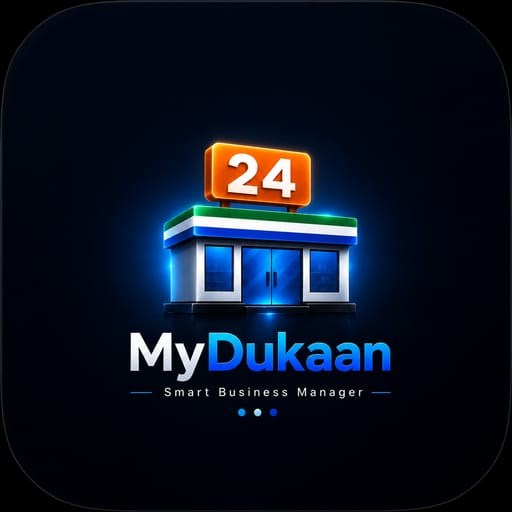
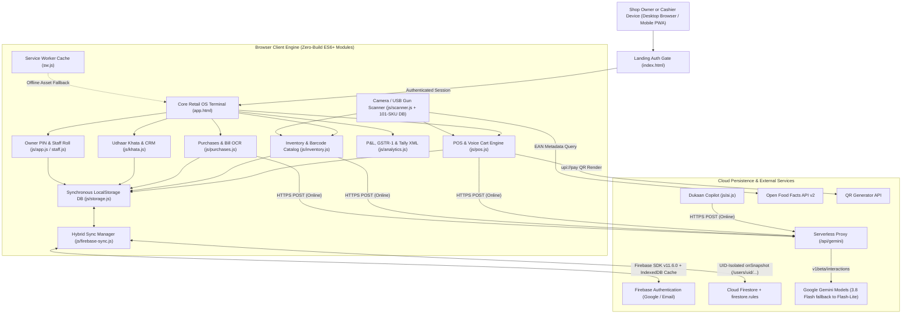
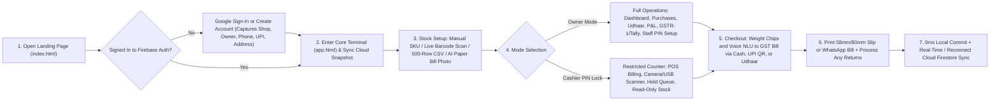

<div align="center">



# MyDukan24

**Offline-First, AI-Powered Digital Store Operating System for Neighborhood Indian Retailers**

*Zero-friction POS billing, loose-weight checkout, 16-language voice cart entry, Udhar credit recovery, GSTR-1 tax reporting, and per-owner Firebase cloud sync — engineered to run from any phone, tablet, or counter PC.*

[](https://mydukaan-eta.vercel.app/)
[](https://mydukaan24.netlify.app/)
[](#20-summary-and-credits)
[](#7-technology-stack)
[](#7-technology-stack)
[](#7-technology-stack)
[](#7-technology-stack)
[](#7-technology-stack)

[Live Landing & Sandbox](https://mydukaan-eta.vercel.app/) | [Live Web POS Terminal (`app.html`)](https://mydukaan-eta.vercel.app/app.html) | [Netlify Deployment Mirror](https://mydukaan24.netlify.app/) | [GitHub Repository](https://github.com/mayursingh24/MyDukaan)

</div>

> **Hackathon Project Identification:** Built as an end-to-end RetailTech hackathon solution (`v9.3`, repository [`mayursingh24/MyDukaan`](https://github.com/mayursingh24/MyDukaan), branded in-app as **MyDukaan24** / **MyDukkan24**). Every capability documented in this README reflects implemented functionality verified directly against the production codebase, with unbuilt extensions transparently separated under [Future Scope](#15-future-scope).

---

## Table of Contents

1. [Project Overview](#1-project-overview)
2. [The Problem: A Story of Every Local Shopkeeper](#2-the-problem-a-story-of-every-local-shopkeeper)
3. [Introducing MyDukan24: Our Solution](#3-introducing-mydukan24-our-solution)
4. [Problems We Solve](#4-problems-we-solve)
5. [MyDukan24 Features](#5-mydukan24-features)
6. [Why MyDukan24?](#6-why-mydukan24)
7. [Technology Stack](#7-technology-stack)
8. [System Architecture: How MyDukan24 Works](#8-system-architecture-how-mydukan24-works)
9. [Application Workflow](#9-application-workflow)
10. [Installation and Local Setup](#10-installation-and-local-setup)
11. [Environment Variables and API Configuration](#11-environment-variables-and-api-configuration)
12. [Deployment: How MyDukan24 Is Hosted](#12-deployment-how-mydukan24-is-hosted)
13. [Project Folder Structure](#13-project-folder-structure)
14. [Screenshots and Live Walkthrough](#14-screenshots-and-live-walkthrough)
15. [Future Scope](#15-future-scope)
16. [Challenges and Learnings](#16-challenges-and-learnings)
17. [Contributing](#17-contributing)
18. [License](#18-license)
19. [Acknowledgements](#19-acknowledgements)
20. [Summary and Credits](#20-summary-and-credits)

---

## 1. Project Overview

**MyDukan24** is a browser-based, offline-first digital retail management operating system designed for independent neighborhood stores (*Kirana* stores, mini-marts, general provision shops, dairy outlets, and local FMCG retailers). Delivered from a zero-build web application and installable Progressive Web App (PWA), it combines sub-second Point-of-Sale (POS) billing, dual decimal-weight and packaged-unit inventory control, camera and USB barcode recognition, customer credit (*Udhar Khata*) management, wholesale supplier ledgers, staff attendance tracking, automated GSTR-1 and TallyPrime reporting, multi-device Firebase Firestore synchronization, and practical Google Gemini AI tools inside one cohesive workspace.

---

## 2. The Problem: A Story of Every Local Shopkeeper

Every evening around 8:30 PM in an Indian neighborhood market, step up to the counter of a typical provision store run by a shopkeeper like **Mahesh**, who has managed his family shop for twelve years.

Five customers stand around a two-meter wooden counter after work. Inside ten minutes, everything collides at once:

- **Mixed weights and packet math under rush pressure:** One customer asks for **500 grams of loose Toor Dal**, **1.5 kg of Basmati Rice**, **250 grams of sugar**, and **two sealed packs of instant noodles**. Half the items must be priced proportionally by decimal weight while the other half sell by sealed MRP. Under noise and impatience, Mahesh punches numbers into a worn pocket calculator and writes the total on a scrap of paper.
- **Blocked billing queues:** Mid-order, a buyer walks back down the aisle after remembering toothpaste. Because there is only one open bill book and one calculator, the next three customers wait silently while an unfinished total sits idle.
- **Spoken regional orders:** A neighborhood elderly regular dictates seven items rapidly in Hindi; a college student adds items in mixed Hinglish. Typing formal English catalog names into traditional computer software only slows the line further.
- **Unrecorded inventory movement and forgotten reorders:** Mahesh stocks **300 to 600 everyday SKUs** across sacks, cartons, and refrigerated shelves. Nobody counts stock daily. On Sunday morning — peak household shopping hours — fast-moving staples like butter, cooking oil, or detergent are suddenly empty because the last packs sold on Friday without triggering a reorder reminder. Meanwhile, perishable packets of milk or bread quietly pass their expiry dates behind fresher rows.
- **The Udhar maze across multiple notebooks:** At least a dozen trusted neighbors say every week: *"Keep this in my account, I will settle at the end of the month."* Mahesh writes dues in a red ruled register, wholesale distributor bills in a clip file, and electricity or freight cash payouts in a pocket diary. When closing the shutter at 10:45 PM, he spends another hour checking totals — yet he still cannot easily answer which customer owes how much since which bill, or send a firm yet polite payment reminder without feeling awkward.
- **Unknown real profit:** Even on days when the cash box feels heavy, Mahesh rarely knows his *actual* take-home profit after subtracting wholesale procurement costs, partial customer returns, utility bills, staff advances, and unpaid Udhar.
- **When modern software also fails him:** The few times Mahesh tried generic desktop ERP suites or Western cloud POS apps, onboarding took hours, monthly subscriptions stacked up, screens froze whenever broadband flickered inside his concrete walls, and shared counter logins exposed his confidential wholesale cost margins to temporary helpers. Entering a forty-line paper distributor bill manually after closing felt worse than staying on pen and paper.

Small neighborhood retailers do not lose money from a lack of hard work — they lose time, margin, and visibility because everyday operations are split across paper registers, mental math, and rigid software never built for local counters.

To survive rising competition and rising compliance demands, local shopkeepers do not need complex corporate ERP jargon; they need an affordable, fast, resilient, and intelligent digital workspace designed around how neighborhood retail actually works.

---

## 3. Introducing MyDukan24: Our Solution

**MyDukan24** was engineered specifically to digitize end-to-end counter, stockroom, ledger, and tax workflows without forcing neighborhood retailers to buy expensive POS hardware or tolerate internet downtime.

### Who Can Use It

- **Kirana and General Provision Stores** selling both pre-packed FMCG goods and loose weighted groceries (`kg`, `g`, `litre`, `ml`, `bag`, `pack`).
- **Mini-Marts and Supermarkets** operating multiple billing lanes or countertop barcode scanner guns.
- **Dairy, Bakery, Snacks, and Household Retailers** managing short shelf-life batches and daily rapid restocking.
- **Owner-Operated Counters with Counter Helpers** requiring PIN-separated financial privacy between owner analytics and cashier billing.

### Product Vision and Practical Impact

- **Speed First (`0 ms` Local Commits):** Billing, cart editing, barcode scanning, and customer lookup never block on a remote server round-trip. Every transaction saves synchronously to local storage first, queues cleanly during network drops, and syncs asynchronously to the shop owner's private Cloud Firestore instance.
- **Designed Around Real Indian Retail Semantics:** First-class support for decimal weights (`250g`, `500g`, `1.5kg`), MRP savings transparency, `0% / 5% / 12% / 18%` GST slabs, partial sales returns, dynamic amount-locked UPI QR codes, Udhar ledger recovery over WhatsApp, and CA-ready GSTR-1 / TallyPrime XML exports.
- **Practical AI Where Data Entry Hurts Most:** Instead of gimmicky chat widgets, Gemini AI directly eliminates manual keyboard toil — converting paper wholesale invoices from camera photos into inward stock bills (`scanPurchaseBill`), parsing 16-language spoken orders into cart quantities (`parseVoiceCart`), identifying unknown EAN/UPC barcodes via web grounding (`lookupBarcode`), forecasting 30-day SKU demand (`predictRestock`), and powering an owner-only financial advisor (`Dukaan Copilot`).

---

## 4. Problems We Solve

Every entry below reflects implemented behavior verified directly in the repository:

| Traditional Shopkeeper Challenge | Root Cause in Pen-and-Paper / Legacy Software | Implemented MyDukan24 Solution |
| :--- | :--- | :--- |
| **Manual sales records & end-of-day tallying** | Multiple paper diaries for cash, UPI, and credit sales take 60+ minutes to reconcile every night. | Automated **POS Billing (`js/pos.js`)**, **Invoices & History**, and **Cash Drawer Z-Report (`F4`)** reconciling Cash, UPI, Card, Udhar, refunds, and daily expenses automatically. |
| **Inventory confusion & hundreds of SKUs** | Hard to maintain cost rates, selling margins, low-stock thresholds, and per-SKU unit types manually. | Unified **Inventory & Stock** ledger (`js/inventory.js`) + separate **Product Catalog & Barcode Price Book** with cost vs. retail valuation, 500+ row bulk CSV import, and printable stock sheets. |
| **Manual loose-weight & mixed-pack billing errors** | Mental fraction math for `250g`, `500g`, or `1.5kg` items causes under-billing or slow queues; rigid tools clutter sealed packet UIs. | Conditional **loose-weight chips** (`250g/500g/1kg/1.5kg/2kg` and `250ml/500ml/1L/1.5L/2L`) appear strictly on weight/volume SKUs while sealed packs keep clean integer controls. |
| **Slow counter bottlenecks & waiting customers** | One customer stepping away for another item stalls the whole checkout queue. | **Hold / Park Cart Queue** stores up to `25` simultaneous open bills so cashiers serve waiting buyers immediately and resume parked orders in one tap. |
| **Language barrier during rush hours** | English-only keyboards slow down Hindi and regional-language counter operators. | **All-Language Voice Billing** across **16 language modes** (`SpeechRecognition` + Gemini NLU + offline Indic script/digit matcher) plus dynamic **EN / Hindi / Hinglish UI switching** (`js/i18n.js`). |
| **Unnoticed product expiry losses** | Dairy, breads, and packaged snacks expire behind front-facing stock. | Date-aware **7-Day Expiry Radar** (`getExpiryMeta`) highlights expired and expiring-within-7-days items on the Dashboard, Inventory filters, and notification popover. |
| **Forgotten stock replenishment** | Shopkeepers discover zero stock only after turning a customer away. | **30-Day Sales Velocity Smart Auto-Restock Engine** calculates average daily movement (`soldQty`), remaining stock days, and recommended pack reorders using online Gemini prediction or deterministic offline rules. |
| **Time-consuming distributor invoice entry** | Typing 30–50 wholesale bill lines at night causes fatigue and outdated cost prices. | **Wholesale Purchases (`js/purchases.js`) & AI Bill Photo Scanner** extracts line items from a distributor invoice photo directly into inward GRNs, updating stock, cost rates, and FIFO vendor payables. |
| **Manual Udhar credit tracking & awkward recovery** | Paper credit pages miss partial payments and lack a fast, polite reminder mechanism. | Separate **Udhaar Khata (`js/khata.js`)** (`Pending Dues / All / Cleared` filters, partial Cash/UPI settlement, printable A4 statements, **1-click WhatsApp + UPI payment links**) and **Customers Loyalty CRM**. |
| **Unknown real profit & GST/Tally stress** | Confusing gross cash receipts with net margin, especially after partial returns and overhead bills. | **Reports & P&L (`js/analytics.js`)** computes return-adjusted Net Revenue, COGS, operating expenses, true Net Profit Margin, **GSTR-1 (`0/5/12/18%` CSV/PDF)**, and **TallyPrime XML Sales Vouchers**. |
| **Wi-Fi dropouts & shared counter security risks** | Cloud-only SaaS halts offline billing; shared terminals expose margins and delete buttons to helpers. | **`0 ms` Offline-First local persistence + Firebase Firestore sync (`js/firebase-sync.js`)** paired with **SHA-256 PIN-locked Cashier Mode** restricting helpers strictly to Billing, Scanner, and Read-Only Stock. |

---

## 5. MyDukan24 Features

### Dashboard

- **Daily Store Pulse:** Displays return-adjusted today's sales, monthly revenue, pending Udhar recovery, inventory asset valuation, and estimated net margin (`js/app.js`).
- **Proactive Alert Banners:** Surfaces critical alerts for **Expiring in <= 7 Days / Expired** items and **Low / Out-of-Stock** SKUs with direct navigation to Inventory filters.
- **Smart Auto-Restock Radar:** Embedded 30-day SKU demand predictor card showing days-of-stock remaining and recommended reorder quantities (`Inventory.generateSmartRestockPlan`).
- **Quick Operations & Notification Bell:** Single-click shortcuts for New Sale, New Product, Add Customer, Record Expense, Supplier Inward, and Dukaan Copilot alongside a live low-stock/expiry/dues notification popover.

### Product Management and Visual Barcode Catalog

- **SKU Master Management:** Track name, category, barcode (`EAN-13 / EAN-8 / UPC / custom`), MRP, selling price, purchase cost, GST slab (`0%, 5%, 12%, 18%`), unit (`pack, bag, bottle, bar, box, tube, kg, litre, ...`), minimum stock alert level, and optional expiry date.
- **Live Online Barcode Auto-Fill:** Scanning or entering a barcode inside the Add Product modal queries Open Food Facts and Gemini Search Grounding to pre-fill item metadata (`Inventory.fetchBarcodePreview`).
- **Dedicated Visual Product Catalog (`products` view):** Displays filterable SKU cards with `% OFF` MRP badges, per-product cumulative sold count and revenue (`soldQty`, `soldRevenue`), deterministic **inline SVG barcode strips**, 1-click **`+ POS Bill`**, **`Print Single Label (6-up sheet)`**, **`Print All Barcodes`**, and **`Print Price List`**.

### Inventory Management

- **Cost vs. Retail Valuation:** Tracks procurement cost basis alongside expected retail realization and markup spread (automatically hidden from Cashiers).
- **Precision Filtering & Search:** Filter by category or operational state (`All`, `Low Stock`, `Out of Stock`, `Expiring <=7d`, `Expired`).
- **500+ Row Bulk CSV/Excel Import:** Paste or upload `.csv` files with flexible header aliases (`name`, `category`, `price`, `mrp`, `cost`, `stock`, `unit`, `barcode`, `gstRate`, `expiryDate`, `minStock`), preview parsed rows before commit, or download a starter template (`Inventory.openBulkCsvModal`).
- **Printable Stock Register:** Exports full formatted A4 inventory sheets (`printStockSheet`).

### Billing and Sales (POS Terminal)

- **Multi-Input Product Capture:** Click product tiles, search via **`Ctrl+K`**, capture with live rear camera (`BarcodeDetector` + bundled ZXing `html5-qrcode.min.js`) or **USB/Bluetooth HID keyboard scanner gun**, or dictate orders via the **16-Language Voice Modal**.
- **Loose-Weight Decimal Billing:** Automatically presents precision presets (`250g`, `500g`, `1kg`, `1.5kg`, `2kg` for mass; `250ml`, `500ml`, `1L`, `1.5L`, `2L` for liquids) on weight/volume SKUs while allowing arbitrary decimal quantities down to `0.05`.
- **Multi-Customer Hold / Park Queue:** Park unfinished customer bills (`Hold`, up to 25 queued carts stored and synced via `meta/store`) and restore any queued cart in one tap.
- **Discounts, GST & Payment Modes:** Flat (`₹`) or percentage (`5%`, `10%`) bill discounts, dynamic per-item slab GST breakdown, automatic MRP savings display, **Cash (`F8`)** with tender change presets (`+₹100`, `+₹200`, `+₹500`, `Exact`), **Dynamic Amount-Locked UPI QR (`F9`)**, **Card**, and **Udhaar Credit (`F10`)**.
- **Thermal Printing & WhatsApp Receipts:** Generates `58mm` or `80mm` thermal receipts (and pre-checkout **Proforma Estimate Slips**) plus pre-filled WhatsApp digital bills.
- **Sales Returns & Refunds:** Process item-level partial or full returns directly from **Invoices & History** (`App.openReturnModal`), restoring inventory quantities, reversing customer credit or cash/UPI payout, adjusting `soldQty`/`soldRevenue`, and preserving invoice return history.

### Customer Management and Udhar Khata

- **Dedicated Udhaar Khata (`udhaar` view):** Focuses purely on receivables (`Pending Dues`, `All Accounts`, `Cleared` filters), recording Cash or UPI settlements with transaction trails, printing A4 account statements, and sending 1-tap WhatsApp reminders embedded with the store's UPI handle.
- **Customers Directory & Loyalty CRM (`customers` view):** Separates loyal buyer CRM (Gold / Silver / Bronze tiers, reward points earned at `1 point per ₹20`, order count, lifetime spend, tier filters, **`New Bill`** POS pre-selection, and printable customer directory).

### Wholesale Purchases, Supplier Ledger, and Staff Controls

- **Supplier Directory & FIFO Payables (`js/purchases.js`):** Track wholesale distributors (`GSTIN`, city, contact person, pending balance), record multi-line inward GRN bills (creating new catalog SKUs inline if needed, updating stock, cost price, and expiry date), and settle vendor dues sequentially across oldest unpaid bills (`FIFO`).
- **31-Day Staff Attendance & Payroll (`js/staff.js`):** Add cashiers/helpers with base salaries, edit employee details, delete profiles cleanly across devices, toggle interactive 31-day attendance (`Present` -> `Half-Day` -> `Absent`), compute pro-rated estimated monthly pay, and print A4 muster rolls.
- **SHA-256 PIN-Locked Role-Based Access (`Owner vs Cashier`):** Hashing an owner 4–6 digit PIN via Web Crypto `SHA-256` (`DB.hashPin`) locks counters into **Cashier Mode** (`data-role="cashier"`), keeping Cost Prices, Wholesale Purchases, Udhaar Settlements, P&L Analytics, Staff Payroll, Record Deletions, and Settings inaccessible without Owner unlock.

### Analytics, Financial Reports, and Tax Compliance

- **Multi-Period Live P&L (`Today`, `7D`, `This Month`, `All Time`):** Computes return-adjusted Gross Billed Sales, Refunds, Net Revenue, COGS, Gross Product Margin, Operating Expenses (Rent, Utilities, Logistics, Salary), and Net Profit Margin (`js/analytics.js`).
- **Dynamic Visual Telemetry:** Pure responsive SVG 7-Day Revenue trend curve, payment mode bars (Cash/UPI/Card/Udhaar), top revenue SKUs, and slow-moving/zero-sale stock capital analysis.
- **Day-End Cash Drawer Z-Report (`F4`):** Reconciles cash inflows against cash refunds and paid expenses alongside UPI and Card settlements for physical drawer closing, printable to thermal/A4 printers.
- **GSTR-1 & TallyPrime Exports:** Export itemized **`0% / 5% / 12% / 18%` GSTR-1 CSV** (slab summary + invoice register), **Printable GSTR-1 Tax Summary PDF**, and **TallyPrime Sales Voucher XML** ready for accounting import.

### AI-Powered Capabilities (`/api/gemini` + Offline Failover)

1. **Dukaan Copilot (`action: "ask"`):** Context-aware business assistant grounded with live inventory counts, low-stock lists, pending Udhar totals, and expense telemetry (`js/ai.js`), paired with an automatic Offline Rule-Based Store Advisor when `navigator.onLine === false`.
2. **AI Paper Bill Photo Scanner (`action: "scanPurchaseBill"`):** Client canvas compresses captured/uploaded distributor bill photos (up to `1280px` JPEG) and calls Gemini Vision structured JSON extraction to populate vendor name, invoice number, date, payment mode, items, quantities, cost rates, and GST slabs into an editable GRN verification modal (`js/purchases.js`).
3. **All-Language Voice Billing NLU (`action: "parseVoiceCart"`):** Translates spoken/typed Hindi Devanagari, Hinglish, and 14 additional regional/global scripts with Indian idioms (`आधा/aadha = 0.5`, `पाव/pav = 0.25`, `डेढ़/dedh = 1.5`, Indic numerals `०१२३...`) strictly against store `catalogHints`, backed by an instant offline multi-script alias matcher (`js/pos.js`).
4. **30-Day Smart Auto-Restock Forecast (`action: "predictRestock"`):** Combines recent `30`-day invoice velocity telemetry with Gemini demand analysis to prioritize urgent restocks and margin recommendations (`js/inventory.js`).
5. **Barcode Search Grounding (`action: "lookupBarcode"`):** Resolves scanned EAN/UPC codes via Gemini with the `google_search` tool enabled, returning structured pricing, GST slab, category, and unit metadata (`api/gemini.js`).

---

## 6. Why MyDukan24?

- **Built for Unstable Networks, Not Ideal Conditions:** Writes commit synchronously (`0 ms`) to `localStorage` and queue into Firestore IndexedDB persistence (`persistentLocalCache`) before network calls ever happen, so counters never stall when cellular signal drops.
- **Zero Build Pipeline, Instant Load:** Written in clean HTML5, CSS3 custom properties (Dark/Light themes + 5 accent palettes), and modular vanilla ES6+ JavaScript — zero `node_modules` bloat, zero bundler step, and immediate execution under `sw.js` Service Worker caching.
- **Strict Tenant Isolation & Counter Safety:** Cloud data is isolated strictly under authenticated per-owner paths (`/users/{uid}/...`) in [`firestore.rules`](firestore.rules), Gemini API keys are explicitly forbidden in cloud rules and kept strictly browser/server-side, and Cashiers cannot view supplier rates or delete records.
- **Multi-Tier Failover Across Both AI and Barcodes:** If the primary Gemini model times out or rate-limits, the serverless proxy steps down cleanly (`gemini-3.8-flash` -> `gemini-3.5-flash-lite` -> `gemini-3.1-flash-lite`). If offline, barcode scanning still checks the synced `barcodeCache`, a `101`-SKU Indian FMCG master table, and `26` GS1 company prefix rules (`890...`).

---

## 7. Technology Stack

| Layer | Technologies Used | Why Used | Role in MyDukan24 | How It Connects |
| :--- | :--- | :--- | :--- | :--- |
| **Frontend UI & Styling** | HTML5, CSS3 Custom Properties, `Inter` & `JetBrains Mono` typography (`index.html`, `app.html`, `css/*.css`) | Instant rendering on entry-level Android phones (`320px+`) and desktop monitors without framework overhead. | Renders the Marketing Landing Gate, POS counter, A4/thermal print templates, Dark/Light themes, and SVG charts. | Served statically with `manifest.json` and `sw.js`; CSS attribute `[data-role="cashier"]` enforces UI-level RBAC alongside JS guards. |
| **Application Logic** | Vanilla JavaScript ES6+ (`js/*.js`) | Predictable synchronous state transitions and zero compilation latency. | Modular engines for Storage (`DB`), POS (`POSEngine`), Inventory, Purchases, Khata, Staff, Analytics, Scanner, i18n, and AI. | Global state passes synchronously through `DB.getData()` / `DB.saveData()`, triggering `CloudSync` debounced delta pushes (`350 ms`). |
| **Client Hardware & Web APIs** | Web Speech API (`SpeechRecognition`), Web Audio API, Web Crypto API (`SHA-256`), `BarcodeDetector`, [`html5-qrcode.min.js`](js/html5-qrcode.min.js), HID `keydown` listener | Eliminates specialized driver installations for mics, beepers, pin hashing, and USB laser scanners. | Captures 16-language voice audio, synthesizes scan beeps/chimes, hashes owner PINs locally, and decodes EAN/UPC/QR codes. | Runs locally inside the browser sandbox, piping parsed codes/transcripts directly into `POSEngine` and `InventoryEngine`. |
| **Backend Serverless AI Proxy** | Node.js Serverless Functions ([`api/gemini.js`](api/gemini.js), [`netlify/functions/gemini.js`](netlify/functions/gemini.js)) | Keeps `GEMINI_API_KEY` private on the server, normalizes schemas, enforces timeouts (`25 s` total budget), and handles CORS cleanly. | Exposes `POST /api/gemini` supporting `lookupBarcode`, `scanPurchaseBill`, `parseVoiceCart`, `predictRestock`, and `ask`. | Browser `DukaanAIEngine` posts JSON payloads to `/api/gemini`; `netlify.toml` and `_redirects` map `/api/gemini` transparently to Netlify Functions. |
| **AI & ML Integration** | Google Gemini Interactions REST API (`v1beta/interactions`, `Api-Revision: 2026-05-20`) | Unified multimodal, Search-grounding, and JSON-schema structured output support across fast Flash tiers. | Performs Vision OCR on bills, multilingual voice NLU, web-grounded barcode lookup, 30-day velocity forecasting, and store chat. | Called server-to-server from `/api/gemini` via `x-goog-api-key` with sequential failover (`gemini-3.8-flash` -> `3.5-flash-lite` -> `3.1-flash-lite`). |
| **Database & Offline Cache** | `localStorage` + Cloud Firestore Standard Edition (`persistentLocalCache`, `persistentMultipleTabManager`) | Provides instant `0 ms` counter writes offline while syncing multi-device state safely online. | Stores `meta/store` (`shop`, `shops`, `parkedCarts`, `attendance`, `barcodeCache`, settings) and 7 isolated collections (`products`, `customers`, `invoices`, `suppliers`, `purchases`, `expenses`, `staff`). | Firebase Modular SDK `v11.6.0` syncs pending local mutations in batches (`chunkArray(..., 350)`) and streams updates back via `onSnapshot`. |
| **Authentication & Security** | Firebase Authentication (Google OAuth popup/redirect + Email/Password + password reset) & [`firestore.rules`](firestore.rules) | Production identity management without maintaining custom auth servers or password tables. | Gates landing exit into `app.html`, isolates tenant data by `request.auth.uid == uid`, and validates document schemas/types/sizes server-side. | Initialized dynamically via ES imports from `gstatic.com/firebasejs/11.6.0/` in `js/firebase-sync.js`. |
| **External Data APIs** | Open Food Facts API v2 (`world.openfoodfacts.org`), QR Server API (`api.qrserver.com`) | Fast free product metadata lookup by EAN and dynamic UPI QR rendering for `upi://pay` strings. | First-pass online lookup for packaged barcodes before Gemini Search fallback; renders amount-locked UPI payment QR images. | Fetched client-side only when `navigator.onLine !== false` (`3.5 s` timeout on Open Food Facts before falling back cleanly). |
| **Hosting & Dev Tooling** | Vercel (`vercel.json`), Netlify (`netlify.toml`, `_redirects`), Firebase CLI (`firebase.json`), Git, VS Code | Dual static + serverless edge deployment with strict security headers and `no-cache` HTML/Service Worker delivery. | Serves static assets globally, routes `/terminal`, `/pos`, `/billing`, `/app` to `app.html`, and deploys `firestore.rules`. | Configured declaratively in root config files without needing build scripts. |

---

## 8. System Architecture: How MyDukan24 Works

MyDukan24 follows an **Offline-First Client + Dual-Cloud Architecture**: every user action executes instantaneously in browser memory and `localStorage`, while authenticated cloud synchronization and serverless Gemini intelligence run asynchronously in parallel.



### Architectural Highlights

1. **Zero Blocking at the Counter:** `DB.saveData()` writes synchronously (`0 ms`) and records mutated record keys (`products`, `customers`, `invoices`, `suppliers`, `purchases`, `expenses`, `staff`, `meta`), avoiding heavy UI locks during billing.
2. **Conflict-Safe Delta Sync & Soft Deletes:** `js/firebase-sync.js` tracks explicit deletions (`deletedIds`) per collection so deleting an employee or SKU on one device propagates cleanly across logged-in devices without resurrection from stale caches.
3. **Strict Online vs. Offline AI Routing:** While `navigator.onLine === true`, AI queries and bill scans hit `/api/gemini` directly so failures surface transparently rather than returning fake AI answers; when `navigator.onLine === false`, the UI switches visibly to deterministic local rule engines, offline alias matchers, and the 101-SKU master registry.
4. **Schema Safety Bridge:** If a self-hosted Firebase project still runs older `v9.0` security rules that reject newer fields (`soldQty`, `soldRevenue`, `transactions`, `attendance`, `barcodeCache`), `FirebaseCloudSync` detects `permission-denied`, automatically activates a legacy-field strip fallback (`stripLegacyV90Payload`), keeps billing uninterrupted, and notifies the owner in Settings to republish [`firestore.rules`](firestore.rules).

---

## 9. Application Workflow



### Step-by-Step Operational Flow

1. **Landing & Access Gate (`index.html`):** Visitors can test the interactive POS simulator, Dynamic UPI QR modal, 80mm receipt preview, live Gemini prompt sandbox, and ROI slider right on the landing page. Clicking **`Open Live POS`** or **`Download App`** enforces authentication via `LandingAuth`, collecting complete store metadata (`shopName`, `ownerName`, `phone`, `upiId`, `address`) during new account registration (`PENDING_SHOP_PROFILE_KEY`).
2. **Boot & Cloud Merge (`app.html`):** On startup, `DB.getData()` loads local store data while `FirebaseCloudSync` attaches `onSnapshot` listeners under `/users/{uid}/meta/store` and the 7 operational subcollections, applying any newly created shop onboarding profile safely once (`applyPendingShopProfile`).
3. **Catalog & Inward Stock Setup:** Shopkeepers populate items via single SKU creation, live camera/USB EAN lookups, bulk `.csv` upload, or snapping a distributor bill photo inside **Wholesale Purchases**.
4. **Counter Checkout & Returns:** Cashiers or owners scan, tap, weigh (`250g`/`500g`/`1kg`), speak in 16 languages, or park bills into the **Hold Queue**. Checkout computes per-item GST slabs and MRP discounts, issues thermal/WhatsApp receipts, decrements stock, increments per-SKU `soldQty`/`soldRevenue`, logs customer loyalty points and Udhar balances, and handles post-sale item returns cleanly.
5. **Nightly Reconciliation & Tax Export:** The owner unlocks **Owner Mode** via their 4–6 digit PIN, closes the Cash Register (`F4` Z-Report), checks 7-day expiry/restock alerts, chases pending Udhar via 1-click WhatsApp reminders, and downloads GSTR-1 CSVs or TallyPrime XML vouchers.

---

## 10. Installation and Local Setup

Because MyDukan24 uses **zero build steps** and ships no `package.json`, `npm install` or compilation is **not required** for local frontend or PWA execution.

### Prerequisites

- **Git** (to clone the repository)
- **One of the following local servers:**
  - **Node.js 18+** (`npx serve .` or `npx vercel dev` / `netlify dev` for full local `/api/gemini` execution), **or**
  - **Python 3** (`python -m http.server`) or VS Code Live Server for frontend testing
- *(Optional for local serverless AI testing)* A **Google Gemini API Key** from [Google AI Studio](https://aistudio.google.com/api-keys)

### Option A: Quick Static Local Launch (Frontend + Firebase Sync)

```bash
# 1. Clone the repository
git clone https://github.com/mayursingh24/MyDukaan.git
cd MyDukaan

# 2. Start any static HTTP server from the repository root
npx serve . -p 3000
# OR with Python 3:
# python -m http.server 3000
```

Then open **`http://localhost:3000/index.html`** or **`http://localhost:3000/app.html`**.

> **Localhost AI Endpoint Note:** Notice that in [`js/ai.js`](js/ai.js#L17-L26) and [`index.html`](index.html#L1103-L1108), when running on `file://`, `localhost`, or `127.0.0.1`, frontend AI requests automatically target the hosted endpoint `https://mydukaan-eta.vercel.app/api/gemini` so static local setups can still test online AI immediately. If you also want to execute your *own* local `/api/gemini` serverless code on localhost, use Option B and update `getEndpoint()` or test via `curl` against `http://localhost:3000/api/gemini`.

### Option B: Full Local + Serverless Function Testing (Vercel CLI / Netlify CLI)

```bash
# 1. Copy environment template and add your real Gemini key
cp .env.example .env
# Edit .env -> GEMINI_API_KEY=your_gemini_api_key_here

# 2. Run local Vercel serverless + static environment
npx vercel dev

# OR run Netlify mirror environment
npx netlify dev
```

*(Ensure `localhost` is listed under **Firebase Console -> Authentication -> Settings -> Authorized domains** if using Google Sign-In against your own Firebase project.)*

---

## 11. Environment Variables and API Configuration

MyDukan24 minimizes secrets by keeping Firebase client identifiers public (secured via UID ownership rules in Firestore) and isolating the Google Gemini secret inside serverless runtime variables.

### Required & Optional Configuration Summary

| Variable / Setting | Where Configured | Required? | Purpose & Security Notes |
| :--- | :--- | :--- | :--- |
| `GEMINI_API_KEY` | Vercel / Netlify Environment Variables or local `.env` | Required for server-side Gemini features | Read by [`api/gemini.js`](api/gemini.js) and [`netlify/functions/gemini.js`](netlify/functions/gemini.js); supports AI Studio keys (`AIza...` and `AQ....`). Never commit real keys to Git. |
| `NODE_ENV` | Vercel / Netlify / `.env` | Optional (`production`) | Standard Node environment flag noted in [`.env.example`](.env.example). |
| `APP_NAME` | `.env` | Optional (`MyDukkan24`) | Application label metadata in [`.env.example`](.env.example). |
| `localStorage['mydukaan_gemini_api_key']` | Browser Storage (via **Set Custom Gemini Key** action) | Optional | Allows a store owner to supply their own Gemini key on-device without storing it in Firestore. Explicit request `apiKey` overrides the server env var per request; explicitly stripped from Firebase cloud sync (`firestore.rules` rejects `geminiKey`). |
| `DEFAULT_FIREBASE_CONFIG` | [`js/firebase-sync.js`](js/firebase-sync.js) | Built-in (`mydukaan24-live`) | Public Firebase Web SDK identifiers (`projectId`, `authDomain`, `appId`, etc.). Can also be overridden locally in `localStorage['mydukaan24_firebase_config']` for self-hosted Firebase projects. |
| Open Food Facts v2 | Client `fetch()` in [`js/scanner.js`](js/scanner.js) | Automatic (no key) | Free public REST endpoint (`https://world.openfoodfacts.org/api/v2/product/{barcode}.json`) queried first when scanning packaged barcodes online. |

### Safe `.env` Example Template ([`.env.example`](.env.example))

```env
# Google Gemini API Key for Dukkan Copilot AI, Bill Vision OCR, Voice NLU & Barcode Grounding (/api/gemini)
# Generate at: https://aistudio.google.com/api-keys
GEMINI_API_KEY=your_gemini_api_key_here

# Application Environment
NODE_ENV=production
APP_NAME=MyDukkan24
```

---

## 12. Deployment: How MyDukan24 Is Hosted

MyDukan24 is deployed in production on **Vercel** with a full-parity mirror configured for **Netlify**, paired with **Firebase Authentication** and **Cloud Firestore**.

### 1. Primary Deployment: Vercel ([`vercel.json`](vercel.json))

- Rewrites friendly paths (`/terminal`, `/pos`, `/billing`, `/app`) cleanly to `/app.html` and fallback routes to `/index.html`.
- Automatically deploys [`api/gemini.js`](api/gemini.js) at `/api/gemini`.
- Enforces `X-Frame-Options: DENY`, `X-Content-Type-Options: nosniff`, `Referrer-Policy: strict-origin-when-cross-origin`, and `Cache-Control: no-cache, no-store, must-revalidate` on HTML documents and `sw.js` so PWA updates take effect immediately.
- **Steps to Deploy:**
  1. Import [`mayursingh24/MyDukaan`](https://github.com/mayursingh24/MyDukaan) into Vercel.
  2. Set Framework Preset to **Other** with empty Build Command and `.` (or default root) Output Directory.
  3. Add **`GEMINI_API_KEY`** under **Project Settings -> Environment Variables** and deploy.

### 2. Mirror Deployment: Netlify ([`netlify.toml`](netlify.toml) & [`_redirects`](_redirects))

- Publishes `.` directly and deploys [`netlify/functions/gemini.js`](netlify/functions/gemini.js).
- Proxies `/api/gemini` transparently (`200`) to `/.netlify/functions/gemini` alongside `/pos`, `/terminal`, `/billing`, and `/app` rewrites.
- Add **`GEMINI_API_KEY`** in **Site configuration -> Environment variables**.

### 3. Firebase Backend Setup ([`firebase.json`](firebase.json), [`firestore.rules`](firestore.rules), [`firestore.indexes.json`](firestore.indexes.json))

1. In [Firebase Console](https://console.firebase.google.com/), enable **Authentication** providers (**Google** + **Email/Password**).
2. Add your production hostnames (e.g., Vercel and Netlify domains) to **Authentication -> Settings -> Authorized domains**.
3. Provision **Cloud Firestore (Standard Edition)**.
4. Deploy [`firestore.rules`](firestore.rules) and [`firestore.indexes.json`](firestore.indexes.json) either via Firebase Console or CLI:

```bash
npm i -g firebase-tools
firebase login
firebase deploy --only firestore
```

---

## 13. Project Folder Structure

```text
c:\MyDukaan-v4\
├── api/
│   └── gemini.js                   # Vercel Node.js serverless proxy for Gemini v1beta/interactions (5 AI actions)
├── netlify/
│   └── functions/
│       └── gemini.js               # Netlify serverless function mirror for /api/gemini
├── assets/
│   ├── LOGO.jpeg                   # Official raster emblem & PWA manifest icon (192/512 target)
│   ├── logo.svg                    # Crisp SVG vector crest used in headers & printed slips
│   └── MyDukkan24-v4.apk           # Minimal Android package manifest archive placeholder (see Section 15)
├── css/
│   ├── style.css                   # Core layout shell, Dark/Light design tokens, 5 accent themes, print rules
│   ├── components.css              # Modular POS cart, tables, badges, modals, scanner & responsive breakpoints
│   └── landing.css                 # Landing showcase styles, glass cards, auth modal & 320px responsive grids
├── docs/
│   └── images/                     # Live UI/UX showcase captures (01-landing-hero.png .. 09-mobile-pos.png + 00-book-cover.jpg)
├── js/
│   ├── html5-qrcode.min.js         # Bundled offline-ready optical QR & 1D barcode decoding library
│   ├── icons.js                    # Inline SVG vector icon system
│   ├── i18n.js                     # Dynamic multi-language UI dictionary engine (English, Hindi, Hinglish)
│   ├── storage.js                  # Synchronous LocalStorage DB, demo seed data, SHA-256 PIN hashing, Web Audio tones
│   ├── firebase-sync.js            # Firebase SDK v11.6.0 Auth, persistent IndexedDB cache, delta sync queue, onSnapshot
│   ├── scanner.js                  # Camera / HID gun scanner, 101-SKU master DB, 26 GS1 prefixes & Open Food Facts client
│   ├── pos.js                      # High-speed POS cart, weight chips, hold queue, 16-lang voice engine, UPI QR & slips
│   ├── inventory.js                # Stock table, expiry countdown radar, 500+ CSV importer, SVG barcode catalog & prints
│   ├── purchases.js                # Wholesale supplier ledger, FIFO settlements, GRN billing & Gemini Bill Photo OCR
│   ├── khata.js                    # Customer Udhaar Credit Ledger, Loyalty CRM & 1-click WhatsApp UPI reminders
│   ├── analytics.js                # Live return-adjusted P&L, 7D SVG chart, GSTR-1 CSV/PDF & TallyPrime XML exports
│   ├── staff.js                    # Employee CRUD, 31-day attendance muster roll & pro-rated payroll calculator
│   ├── ai.js                       # Dukaan Copilot chat modal & strict online/offline rule-based store advisor failover
│   └── app.js                      # App router, RBAC Owner/Cashier guard, Z-Report cash drawer, settings & JSON restore
├── index.html                      # Product landing page, interactive POS/AI sandbox & mandatory Firebase Auth gate
├── app.html                        # Authenticated Retail Business OS terminal workspace
├── manifest.json                   # PWA install manifest with standalone display & app shortcuts
├── sw.js                           # Network-First v9.3 Service Worker with offline navigation fallback
├── vercel.json                     # Vercel routing rewrites & cache/security headers
├── netlify.toml                    # Netlify publish config, redirects & security headers
├── _redirects                      # Netlify URL redirect rules
├── firebase.json                   # Firebase CLI config linking firestore.rules and firestore.indexes.json
├── firestore.rules                 # Per-UID strict Firestore isolation & field-level schema validation rules
├── firestore.indexes.json          # Firestore index manifest
├── .env.example                    # Safe environment variable template for serverless GEMINI_API_KEY
├── .gitignore                      # Ignores .env, node_modules, logs, and OS artifacts
└── README.md                       # Complete product & technical documentation (this file)
```

---

## 14. Screenshots and Live Walkthrough

All screenshots below were captured directly from the live application using clean demonstration store data (`MyDukkan24 Demo Mart`). *(Note: dedicated secondary views such as Customers Loyalty CRM, Udhaar Khata, Staff 31-Day Attendance, Settings/Cloud Telemetry, and Printable SVG Barcode Price Book share the same UI architecture and can be explored live in the [deployed app](https://mydukaan-eta.vercel.app/app.html).)*

### Landing Hero and Interactive Online Sandbox

Visitors can explore interactive cart totals, amount-locked UPI QR previews, live Gemini AI store queries, and all retail engines before authenticating to enter the full terminal.

| Landing Hero Stage | Interactive POS & Live AI Sandbox |
| :---: | :---: |
|  |  |

### Executive Dashboard and POS Billing Terminal

Real-time store pulse with 7-day expiry/restock warnings alongside rapid POS checkout with queued hold carts, conditional loose-weight chips on `kg`/`litre` items, slab GST breakdown, and cash tender presets.

| Executive Dashboard | POS Billing Terminal |
| :---: | :---: |
|  |  |

### Inventory Expiry Control and Wholesale Bill Photo OCR

Cost-vs-retail stock valuation, expiry countdown badges, bulk CSV import tools, and Gemini Vision paper distributor bill extraction with FIFO supplier credit tracking.

| Inventory & Expiry Radar | Wholesale Purchases & AI Bill Scanner |
| :---: | :---: |
|  |  |

### Financial P&L, GSTR-1 / Tally XML, Dukaan Copilot, and Mobile Counter POS

Dynamic net revenue curves net of customer returns, `0% / 5% / 12% / 18%` GSTR-1 slab tables, store-grounded Copilot insights, and responsive `320px+` mobile billing with floating sticky cart summary.


| Dukaan Copilot (Live Gemini API) | Mobile Responsive POS (`320px+`) |
| :---: | :---: |
|  |  |

---

## 15. Future Scope

The following enhancements are planned roadmap items **not yet implemented** in the current `v9.3` release:

- **Native Android Binary / Trusted Web Activity (TWA) APK:** Compile a signed production Android APK wrapping the PWA with native OS intents. *(Transparency note: [`assets/MyDukkan24-v4.apk`](assets/MyDukkan24-v4.apk) is currently a `461`-byte manifest placeholder archive; mobile users today install the full application via the browser **Install PWA / Add to Home Screen** flow configured in [`manifest.json`](manifest.json).)*
- **Direct Web Bluetooth ESC/POS Thermal Printing:** Connect portable `58mm` and `80mm` Bluetooth thermal printers directly from Chrome without opening the system print dialog.
- **Automated UPI Webhook / Soundbox Confirmation:** Verify incoming GPay/PhonePe/Paytm settlements automatically via merchant PSP webhooks with Hindi spoken amount announcements.
- **Public Hyperlocal WhatsApp & ONDC Storefront:** Expose live in-stock catalog feeds for neighborhood buyers to browse prices and place WhatsApp pickup/delivery orders.
- **Multi-Branch Consolidated Accounting & Stock Transfers:** While settings currently store multi-shop profile metadata (`shops` / `activeShopId`), future versions will enable branch-isolated invoice prefixes, inter-store stock transfer vouchers, and consolidated chain GST reports.
- **Digital Weighing Scale Hardware Sync:** Read live gram weights straight from counter weighing scales over Web Serial or Bluetooth Low Energy (`BLE`).
- **Automated Supplier Purchase Order Dispatch:** Trigger draft PDF/WhatsApp Purchase Orders automatically when 30-day SKU demand drops below a configurable reorder threshold.

---

## 16. Challenges and Learnings

1. **Keeping Counter Writes at `0 ms` Without Losing Multi-Device Integrity:**
   Writing to Cloud Firestore on every keypress or quantity click stalls slow rural connections. Decoupling synchronous `localStorage` commits from a `350 ms` debounced dirty-queue reconciler—backed by explicit `deletedIds` tombstones in `js/firebase-sync.js`—taught us how to prevent stale devices from resurrecting deleted staff or SKUs while keeping the UI responsive.
2. **Accurate GST Slabs & P&L Net of Partial Sales Returns:**
   In neighborhood shops, customers frequently return two items from a five-item discounted GST bill. Calculating slab-wise `GSTR-1` CSVs and `TallyPrime` XML proportionally across returned item quantities and per-invoice discount ratios in [`js/analytics.js`](js/analytics.js) required carefully normalizing legacy and modern invoice schemas so CA numbers always foot cleanly.
3. **Making Multimodal AI Dependable Under Edge Limits:**
   Different Gemini preview/flash tiers can vary in latency or reject `response_format` + `google_search` combinations on specific inputs. Implementing sequential failover (`gemini-3.8-flash` -> `gemini-3.5-flash-lite` -> `gemini-3.1-flash-lite`) with clean HTTP `400` schema-free fallback retries inside a strict `25 s` serverless ceiling—while keeping deterministic offline fallbacks visibly separate when `navigator.onLine === false`—made AI tools practical for real billing rather than brittle demos.
4. **Backward-Compatible Cloud Schema Evolution:**
   Deploying richer fields (`soldQty`, `soldRevenue`, `attendance`, `barcodeCache`, `parkedCarts`, `transactions`) risks breaking live users if their Firestore security rules have not been republished yet. Detecting `permission-denied` dynamically and stripping newly added keys on the fly (`stripLegacyV90Payload`) keeps shops billing cleanly while prompting owners to upgrade [`firestore.rules`](firestore.rules).
5. **Fitting Full-Power Retail Tables and Thermal Modals Into `320px` Screens:**
   Designing thermal slips (`58mm/80mm`), multi-column P&L tables, Hold Cart drawers, and sticky bottom cart bars without horizontal page overflow on compact Android devices required careful fluid CSS grids (`minmax(min(100%, ...), 1fr)`), isolated print containers (`#thermal-printable-area`), and dedicated sticky footers inside viewport-bounded modals (`max-height: 90dvh`).

---

## 17. Contributing

Contributions, bug reports, and regional retail workflow improvements are welcome:

1. **Fork** the repository on GitHub (`https://github.com/mayursingh24/MyDukaan`).
2. Create a clean feature branch:
   ```bash
   git checkout -b feat/your-improvement
   ```
3. Keep changes aligned with the existing **zero-build modular vanilla ES6+ architecture** (no unsolicited heavy build toolchains).
4. Verify your changes against both desktop (`>=1280px`) and compact mobile (`320px–375px`) viewports, plus offline behavior (`navigator.onLine === false`).
5. Ensure no API keys, personal phone numbers, or sensitive `.env` secrets are staged, and commit using concise conventional messages:
   ```bash
   git commit -m "feat(pos): improve thermal print margin wrapping"
   ```
6. Open a **Pull Request** describing the retail problem solved, files changed, and verification steps.

---

## 18. License

No `LICENSE` file is currently present in the root of this repository (`c:\MyDukaan-v4`). Before distributing forks or deploying commercial derivatives, add a standard open-source license file (such as **MIT License**) or clarify usage permissions directly with the repository author.

All project source code, assets, and documentation in this repository are authored by **Mayur Singh** (2026).

---

## 19. Acknowledgements

- **Google Gemini Interactions API** (`v1beta/interactions`) for fast multimodal invoice Vision OCR, 16-language NLU parsing, Search-grounded barcode lookup, and retail insights.
- **Firebase Authentication & Cloud Firestore** (`v11.6.0` Modular Web SDK) for zero-server auth, offline IndexedDB persistence, and multi-device sync.
- **Open Food Facts (`world.openfoodfacts.org`)** for open community consumer product metadata and packaging lookup.
- **mebjas / `html5-qrcode`** (`ZXing` wrapper) for client-side cross-browser camera barcode and QR decoding without native plugins.
- **Vercel** and **Netlify** for global edge static hosting and instant Node.js serverless function execution.
- Neighborhood Kirana owners in Lucknow whose everyday counter pain points inspired every shortcut, weight chip, and ledger button across the system.

---

## 20. Summary and Credits

**"MyDukan24 – Empowering Local Businesses Through Smart Technology."**

| Project Metadata | Details |
| :--- | :--- |
| **Project Name** | **MyDukan24** (in-app branding: `MyDukaan24` / `MyDukkan24`) |
| **Hackathon Tag** | RetailTech & Smart Local Commerce Showcase (`v9.3` Production Build) |
| **Live Production URL (Vercel)** | [https://mydukaan-eta.vercel.app/](https://mydukaan-eta.vercel.app/) |
| **Live Web POS Terminal** | [https://mydukaan-eta.vercel.app/app.html](https://mydukaan-eta.vercel.app/app.html) |
| **Live Mirror (Netlify)** | [https://mydukaan24.netlify.app/](https://mydukaan24.netlify.app/) |
| **GitHub Repository** | [https://github.com/mayursingh24/MyDukaan](https://github.com/mayursingh24/MyDukaan) |
| **Author & Developer** | **Mayur Singh** (Lucknow, India) — [GitHub (`mayursingh24`)](https://github.com/mayursingh24) · [LinkedIn (`mayursingh24`)](https://linkedin.com/in/mayursingh24) |
